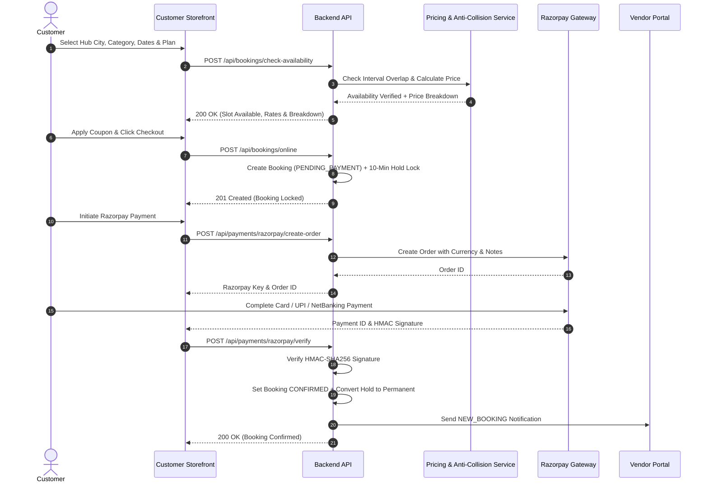
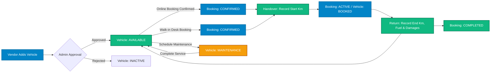

# RentRide — Complete Functionality Map

> **Document Type:** Functional Scope & Feature Hierarchy Map  
> **Application:** RentRide Vehicle Rental Marketplace  
> **Version:** 1.3.0  
> **Status:** Verified from Live Codebase  

---

## 1. Functional Scope & Feature Hierarchy Tree

```text
RENTRIDE
│
├── 1. Authentication & Identity Management
│   ├── Customer Authentication [IMPLEMENTED]
│   │   ├── Registration (Name, Email, Phone, Password, DL Number) [IMPLEMENTED]
│   │   ├── Login (Email, Password) [IMPLEMENTED]
│   │   └── Session Logout [IMPLEMENTED]
│   │
│   ├── Vendor Authentication [IMPLEMENTED]
│   │   ├── Vendor Onboarding & Registration (Business Name, GST, Operating Hub) [IMPLEMENTED]
│   │   ├── Login [IMPLEMENTED]
│   │   └── Session Logout [IMPLEMENTED]
│   │
│   ├── Admin Authentication [IMPLEMENTED]
│   │   ├── Secure Admin Login [IMPLEMENTED]
│   │   └── Session Logout [IMPLEMENTED]
│   │
│   ├── Profile & Account Management [IMPLEMENTED]
│   │   ├── View Account Details [IMPLEMENTED]
│   │   ├── Update Customer Contact & Driving License [IMPLEMENTED]
│   │   ├── Update Vendor Business Profile, GST & Operating City [IMPLEMENTED]
│   │   ├── Avatar Image Upload (Cloudinary Integration) [IMPLEMENTED]
│   │   └── Change Password [IMPLEMENTED]
│   │
│   └── Role-Based Access Control (RBAC) [IMPLEMENTED]
│       ├── Route Guards (Public, Protected, Role-Restricted) [IMPLEMENTED]
│       └── Role Enforcement (CUSTOMER, VENDOR, ADMIN) [IMPLEMENTED]
│
├── 2. Customer: Vehicle Discovery & Marketplace
│   ├── Marketplace Storefront [IMPLEMENTED]
│   │   ├── Hero Search Banner [IMPLEMENTED]
│   │   ├── Platform Trust Metrics Strip [IMPLEMENTED]
│   │   ├── Category Explorer Cards [IMPLEMENTED]
│   │   ├── Featured Fleet Showcase [IMPLEMENTED]
│   │   ├── AI Trip Matcher Prompt [IMPLEMENTED]
│   │   ├── "How It Works" Step-by-Step Guide [IMPLEMENTED]
│   │   ├── Customer Testimonials & Verified Reviews [IMPLEMENTED]
│   │   └── Vendor Onboarding Call-to-Action [IMPLEMENTED]
│   │
│   ├── Operating Hub & City Discovery [IMPLEMENTED]
│   │   ├── Supported Hubs Selection (Indore, Bhopal, Gwalior) [IMPLEMENTED]
│   │   ├── City Autocomplete Suggestion Dropdown [IMPLEMENTED]
│   │   └── Cross-City All-Hubs Search Mode [IMPLEMENTED]
│   │
│   ├── Vehicle Category Browsing [IMPLEMENTED]
│   │   ├── Electric Scooters (2-Wheeler) [IMPLEMENTED]
│   │   ├── Standard Scooters (2-Wheeler) [IMPLEMENTED]
│   │   ├── Geared Motorcycles & Bikes (2-Wheeler) [IMPLEMENTED]
│   │   ├── Hatchback Cars (4-Wheeler) [IMPLEMENTED]
│   │   ├── Sedan Cars (4-Wheeler) [IMPLEMENTED]
│   │   └── SUVs & Adventure Vehicles (4-Wheeler) [IMPLEMENTED]
│   │
│   ├── Rental Plans & Pricing Models [IMPLEMENTED]
│   │   ├── Hourly Rental Plan (Flexible Short Trips) [IMPLEMENTED]
│   │   ├── 12-Hour Rental Plan (Day Trips & Work Commutes) [IMPLEMENTED]
│   │   ├── 24-Hour Rental Plan (Overnight & Weekend Getaways) [IMPLEMENTED]
│   │   └── Plan Rate Comparison Calculator [IMPLEMENTED]
│   │
│   ├── Faceted Fleet Search & Filtering [IMPLEMENTED]
│   │   ├── Search by Brand & Model Name [IMPLEMENTED]
│   │   ├── Filter by Category (Slug / ID) [IMPLEMENTED]
│   │   ├── Filter by Vehicle Type (2-Wheeler vs 4-Wheeler) [IMPLEMENTED]
│   │   ├── Filter by Propulsion / Fuel Type (Petrol, Diesel, Electric, Hybrid) [IMPLEMENTED]
│   │   ├── Filter by Transmission (Manual vs Automatic) [IMPLEMENTED]
│   │   ├── Filter by Maximum Price Slider [IMPLEMENTED]
│   │   ├── Active Filter Chips (Removable / Clear All) [IMPLEMENTED]
│   │   └── Real-time URL Search Parameters Synchronization [IMPLEMENTED]
│   │
│   ├── Sorting & View Modes [IMPLEMENTED]
│   │   ├── Sort by Popular / Recommended [IMPLEMENTED]
│   │   ├── Sort by Newest Listings [IMPLEMENTED]
│   │   ├── Sort by Price (Low to High / High to Low) [IMPLEMENTED]
│   │   ├── Sort by Highest Rated [IMPLEMENTED]
│   │   ├── Responsive Fleet Grid View [IMPLEMENTED]
│   │   └── Interactive Map Hub View [PARTIAL]
│   │
│   └── Vehicle Details & Specifications [IMPLEMENTED]
│       ├── High-Resolution Image Gallery [IMPLEMENTED]
│       ├── Technical Specifications (Fuel, Transmission, Seats, Engine CC/kWh) [IMPLEMENTED]
│       ├── Feature Badges & Inclusions (ABS, Helmets, Fast Charge, Sunroof) [IMPLEMENTED]
│       ├── Operating Hub & Pickup Location Address [IMPLEMENTED]
│       ├── Verified Vendor Information Badge [IMPLEMENTED]
│       ├── Live Rental Price Estimator [IMPLEMENTED]
│       ├── Real-time Interval Availability Conflict Checker [IMPLEMENTED]
│       └── Customer Ratings & Feedback Feed [IMPLEMENTED]
│
├── 3. Customer: Booking & Rental Lifecycle
│   ├── Slot Availability & Anti-Collision Engine [IMPLEMENTED]
│   │   ├── Zero-Collision Interval Validation Algorithm [IMPLEMENTED]
│   │   ├── Active Rental Conflict Detection [IMPLEMENTED]
│   │   └── Scheduled Maintenance Window Conflict Detection [IMPLEMENTED]
│   │
│   ├── Transparent Price Calculation [IMPLEMENTED]
│   │   ├── Server-Side Base Rate Calculation [IMPLEMENTED]
│   │   ├── Dynamic Weekend Surge Multiplier (1.15x) [IMPLEMENTED]
│   │   ├── Platform Fee Calculation (5%) [IMPLEMENTED]
│   │   ├── GST / Tax Calculation (18%) [IMPLEMENTED]
│   │   ├── Refundable Security Deposit Inclusion [IMPLEMENTED]
│   │   └── Vendor Payout & Platform Commission Split (88% / 12%) [IMPLEMENTED]
│   │
│   ├── Promotional Discount Engine [IMPLEMENTED]
│   │   ├── Promo Code Validation [IMPLEMENTED]
│   │   ├── Percentage Discount with Maximum Cap [IMPLEMENTED]
│   │   ├── Fixed Discount Value [IMPLEMENTED]
│   │   ├── Minimum Order Amount Check [IMPLEMENTED]
│   │   └── Per-User and Global Usage Limit Enforcement [IMPLEMENTED]
│   │
│   ├── Online Reservation & Checkout [IMPLEMENTED]
│   │   ├── 10-Minute Reservation Hold Lock (Anti-Double-Booking TTL) [IMPLEMENTED]
│   │   ├── Driving License & Identity Verification Confirmation [IMPLEMENTED]
│   │   ├── Trip Interval Review [IMPLEMENTED]
│   │   └── Itemized Price Breakdown Review [IMPLEMENTED]
│   │
│   └── Customer Booking Management [IMPLEMENTED]
│       ├── My Bookings Dashboard (Upcoming, Active, Completed, Cancelled) [IMPLEMENTED]
│       ├── Booking Summary & Digital Receipt [IMPLEMENTED]
│       ├── Pickup & Return Details [IMPLEMENTED]
│       ├── Rental Cancellation Workflow [IMPLEMENTED]
│       └── Progressive Refund Calculation [PARTIAL]
│
├── 4. Payments & Financial Transactions
│   ├── Online Payment Gateway Integration [IMPLEMENTED]
│   │   ├── Razorpay Server-Side Order Creation [IMPLEMENTED]
│   │   ├── Razorpay Modal Checkout [IMPLEMENTED]
│   │   ├── Cryptographic HMAC-SHA256 Signature Verification [IMPLEMENTED]
│   │   ├── Hold Lock to Confirmed Booking Transition [IMPLEMENTED]
│   │   └── Payment Failure Logging & Recovery [IMPLEMENTED]
│   │
│   └── Financial Ledger & Transaction History [IMPLEMENTED]
│       ├── User Transaction History [IMPLEMENTED]
│       └── Vendor Payout Ledger [IMPLEMENTED]
│
├── 5. Vendor: Fleet Dispatch & Operations Portal
│   ├── Operations Dashboard [IMPLEMENTED]
│   │   ├── Real-time Fleet Metrics (Total, Available, In Maintenance) [IMPLEMENTED]
│   │   ├── Rental Statistics (Active, Upcoming, Completed, Total) [IMPLEMENTED]
│   │   ├── Financial KPI Cards (Gross GMV, Net Earnings, Pending Payouts) [IMPLEMENTED]
│   │   └── AI Demand & Market Trends Preview [IMPLEMENTED]
│   │
│   ├── Vehicle Fleet Management (CRUD) [IMPLEMENTED]
│   │   ├── Add New Vehicle Listing [IMPLEMENTED]
│   │   │   ├── Brand, Model, Year, Registration Number [IMPLEMENTED]
│   │   │   ├── Category Selection [IMPLEMENTED]
│   │   │   ├── Fuel, Transmission, Seating Capacity, Engine Size [IMPLEMENTED]
│   │   │   ├── Hourly, 12-Hour, 24-Hour Pricing & Security Deposit [IMPLEMENTED]
│   │   │   ├── Hub City, State, Street Address [IMPLEMENTED]
│   │   │   ├── Feature Pills (Bluetooth, ABS, Helmet, Sunroof) [IMPLEMENTED]
│   │   │   └── Cloudinary Multi-Image Upload [IMPLEMENTED]
│   │   ├── Update Vehicle Details & Rates [IMPLEMENTED]
│   │   ├── Delete Vehicle Listing [IMPLEMENTED]
│   │   ├── Quick Status Toggle (AVAILABLE, MAINTENANCE, INACTIVE) [IMPLEMENTED]
│   │   └── Fleet Filter & Inventory Search [IMPLEMENTED]
│   │
│   ├── Unified Fleet Bookings Management [IMPLEMENTED]
│   │   ├── Combined Online & Offline Bookings List [IMPLEMENTED]
│   │   ├── Filter by Booking Status (Confirmed, Active, Completed, Cancelled) [IMPLEMENTED]
│   │   └── Filter by Channel (Online vs Offline Walk-in) [IMPLEMENTED]
│   │
│   ├── Offline Walk-in Desk Booking [IMPLEMENTED]
│   │   ├── Walk-in Customer Capture (Name, Phone, Driving License) [IMPLEMENTED]
│   │   ├── Vehicle & Interval Selection [IMPLEMENTED]
│   │   ├── Instant Anti-Collision Availability Check [IMPLEMENTED]
│   │   ├── Custom Desk Rate Override [IMPLEMENTED]
│   │   ├── Cash / UPI Payment Collection at Desk [IMPLEMENTED]
│   │   └── Instant Confirmed Reservation Creation [IMPLEMENTED]
│   │
│   ├── Vehicle Handover & Trip Start [IMPLEMENTED]
│   │   ├── Handover Modal Checklist [IMPLEMENTED]
│   │   ├── Start Odometer (km) Recording [IMPLEMENTED]
│   │   ├── Handover Condition Notes [IMPLEMENTED]
│   │   ├── Transition Booking Status to ACTIVE [IMPLEMENTED]
│   │   └── Transition Vehicle Status to BOOKED [IMPLEMENTED]
│   │
│   ├── Vehicle Return & Trip Completion [IMPLEMENTED]
│   │   ├── Return Modal Checklist [IMPLEMENTED]
│   │   ├── End Odometer (km) Recording & Distance Driven Calculation [IMPLEMENTED]
│   │   ├── Fuel Level Inspection [IMPLEMENTED]
│   │   ├── Damage Incident Reporting [IMPLEMENTED]
│   │   ├── Extra Kilometer / Late Return Charges Assessment [IMPLEMENTED]
│   │   ├── Transition Booking Status to COMPLETED [IMPLEMENTED]
│   │   └── Release Vehicle Status back to AVAILABLE [IMPLEMENTED]
│   │
│   └── Fleet Maintenance Scheduling [IMPLEMENTED]
│       ├── Schedule Maintenance Modal [IMPLEMENTED]
│       ├── Service Type (Routine, Repair, Inspection) [IMPLEMENTED]
│       ├── Service Interval (Start Date to End Date) [IMPLEMENTED]
│       ├── Garage / Service Center Name & Estimated Cost [IMPLEMENTED]
│       ├── Automatic Slot Blocking (Prevents Booking Collisions) [IMPLEMENTED]
│       ├── Complete Maintenance Modal [IMPLEMENTED]
│       └── Actual Cost & Work Done Logging [IMPLEMENTED]
│
├── 6. Master Admin: Governance & Platform Control
│   ├── Master Analytics & Financial Oversight [IMPLEMENTED]
│   │   ├── Platform Overview Metrics (Users, Vendors, Vehicles, Bookings) [IMPLEMENTED]
│   │   ├── Gross Merchandise Value (GMV) Aggregation [IMPLEMENTED]
│   │   ├── Platform Commission Revenue Aggregation [IMPLEMENTED]
│   │   ├── Total Vendor Payout Liability [IMPLEMENTED]
│   │   └── Recent Bookings Audit Stream [IMPLEMENTED]
│   │
│   ├── Vehicle Moderation & Approval Engine [IMPLEMENTED]
│   │   ├── Pending Vehicle Approvals Queue [IMPLEMENTED]
│   │   ├── Vehicle Verification Inspection [IMPLEMENTED]
│   │   ├── Approve Vehicle Listing (Sets to AVAILABLE) [IMPLEMENTED]
│   │   ├── Reject Vehicle Listing (Sets to INACTIVE with Reason) [IMPLEMENTED]
│   │   └── Instant Notification Dispatch to Vendor [IMPLEMENTED]
│   │
│   ├── User & Vendor Governance [IMPLEMENTED]
│   │   ├── Registered Users Directory (Customers, Vendors, Admins) [IMPLEMENTED]
│   │   ├── Filter by Role [IMPLEMENTED]
│   │   └── Search Users by Name, Email, or Phone [IMPLEMENTED]
│   │
│   ├── Global Bookings Audit Trail [IMPLEMENTED]
│   │   ├── Platform-wide Bookings Directory [IMPLEMENTED]
│   │   ├── Status-based Filtering [IMPLEMENTED]
│   │   └── Customer, Vendor, Vehicle & Payout Inspection [IMPLEMENTED]
│   │
│   ├── Promotional Coupon Governance (CRUD) [IMPLEMENTED]
│   │   ├── Coupon Manager Interface [IMPLEMENTED]
│   │   ├── Create Coupon (Code, Discount Type, Discount Value, Limits) [IMPLEMENTED]
│   │   ├── Edit Coupon Parameters [IMPLEMENTED]
│   │   ├── Toggle Active / Inactive Status [IMPLEMENTED]
│   │   ├── Delete Coupon [IMPLEMENTED]
│   │   └── Real-time Usage Tracker [IMPLEMENTED]
│   │
│   └── Vehicle Category Management [IMPLEMENTED]
│       ├── Category Listing & Types [IMPLEMENTED]
│       ├── Create Category (Admin API) [IMPLEMENTED]
│       ├── Update Category Details (Admin API) [IMPLEMENTED]
│       └── Delete Category (Admin API) [IMPLEMENTED]
│
├── 7. Reviews & Verified Ratings
│   ├── Customer Review Submission [IMPLEMENTED]
│   │   ├── Post-Trip Review Modal Form [IMPLEMENTED]
│   │   ├── Star Rating (1 to 5 Stars) [IMPLEMENTED]
│   │   └── Written Feedback & Title [IMPLEMENTED]
│   │
│   ├── Rating Aggregation Pipeline [IMPLEMENTED]
│   │   ├── MongoDB Aggregation Calculating Average Rating [IMPLEMENTED]
│   │   ├── Total Review Count Increment [IMPLEMENTED]
│   │   └── Real-time Vehicle Schema Update [IMPLEMENTED]
│   │
│   └── Vehicle Review Feed [IMPLEMENTED]
│       ├── Review Cards Display on Vehicle Details [IMPLEMENTED]
│       └── Verified Customer Badge [IMPLEMENTED]
│
├── 8. Notifications & Alerts
│   ├── Notification Feed [IMPLEMENTED]
│   │   ├── Navbar Dropdown Bell with Unread Badge Counter [IMPLEMENTED]
│   │   ├── Mark Single Notification as Read [IMPLEMENTED]
│   │   └── Mark All Notifications as Read [IMPLEMENTED]
│   │
│   └── Automated Notification Triggers [IMPLEMENTED]
│       ├── Welcome & System Announcements [IMPLEMENTED]
│       ├── Booking Confirmation (Customer) [IMPLEMENTED]
│       ├── New Booking Alert (Vendor) [IMPLEMENTED]
│       ├── Booking Cancellation Notice (Customer & Vendor) [IMPLEMENTED]
│       ├── Trip Started & Initial Odometer Notice (Customer) [IMPLEMENTED]
│       ├── Trip Completed & Distance Driven Notice (Customer) [IMPLEMENTED]
│       └── Vehicle Listing Approved / Rejected (Vendor) [IMPLEMENTED]
│
├── 9. AI & Machine Learning Features
│   ├── FastAPI AI Microservice [IMPLEMENTED]
│   │   ├── Python FastAPI Backend with Pydantic v2 Validation [IMPLEMENTED]
│   │   └── Internal Service-to-Service API Key Guard [IMPLEMENTED]
│   │
│   ├── Personalized Vehicle Recommendations [IMPLEMENTED]
│   │   ├── Multi-Attribute Scoring Engine [IMPLEMENTED]
│   │   ├── Preference Matching (Budget, Category, Fuel, Transmission) [IMPLEMENTED]
│   │   ├── Customer Rating & Popularity Weighting [IMPLEMENTED]
│   │   ├── Heuristic Fallback Engine (Resilient if AI offline) [IMPLEMENTED]
│   │   └── Frontend AI Recommendation Carousel [IMPLEMENTED]
│   │
│   ├── 7-Day Demand Forecasting [IMPLEMENTED]
│   │   ├── Day-of-Week Seasonality Analysis [IMPLEMENTED]
│   │   ├── City & Metro Multipliers [IMPLEMENTED]
│   │   ├── Fleet Utilization Pressure Integration [IMPLEMENTED]
│   │   ├── Surge Level Classification (Low, Moderate, High, Peak) [IMPLEMENTED]
│   │   └── Vendor Demand Forecast Widget & Utilization Visualizer [IMPLEMENTED]
│   │
│   └── Dynamic Pricing Engine [IMPLEMENTED]
│       ├── Real-time Optimal Rate Multiplier Calculation [IMPLEMENTED]
│       ├── Fleet Scarcity Surge (>75% utilization) [IMPLEMENTED]
│       ├── Weekend Demand Surge (+15%) [IMPLEMENTED]
│       ├── Metro Multiplier [IMPLEMENTED]
│       ├── Bounded Multiplier (0.90x to 1.35x) [IMPLEMENTED]
│       └── Potential Revenue Uplift Estimation [IMPLEMENTED]
│
└── 10. Shared Platform Infrastructure & Utilities
    ├── Resilient Database Fallback & Seeding [IMPLEMENTED]
    │   ├── Primary MongoDB Atlas Connection [IMPLEMENTED]
    │   ├── In-Memory MongoDB Fallback (`mongodb-memory-server`) [IMPLEMENTED]
    │   └── Auto-Seeding of Categories, Users & Vehicles across Hubs [IMPLEMENTED]
    │
    ├── Asset Management [IMPLEMENTED]
    │   ├── Cloudinary Multi-Image Upload [IMPLEMENTED]
    │   └── Cloudinary Asset Deletion on Vehicle Removal [IMPLEMENTED]
    │
    └── Error Handling & Validation [IMPLEMENTED]
        ├── Centralized API Error Response Formatter [IMPLEMENTED]
        ├── Express Global Error Middleware [IMPLEMENTED]
        ├── Client-side Axios Error Interceptor with Contextual Messages [IMPLEMENTED]
        └── Zod Schema Validation for Form & Request Payloads [IMPLEMENTED]
```

---

## 2. Mermaid Functional Architecture Diagrams

### 2.1 Overall System Functional Map

```mermaid
graph TD
    classDef auth fill:#f97316,stroke:#c2410c,stroke-width:2px,color:#ffffff;
    classDef cust fill:#3b82f6,stroke:#1d4ed8,stroke-width:2px,color:#ffffff;
    classDef vend fill:#10b981,stroke:#047857,stroke-width:2px,color:#ffffff;
    classDef adm fill:#8b5cf6,stroke:#6d28d9,stroke-width:2px,color:#ffffff;
    classDef ai fill:#ec4899,stroke:#be185d,stroke-width:2px,color:#ffffff;
    classDef core fill:#334155,stroke:#0f172a,stroke-width:2px,color:#ffffff;

    App[RENTRIDE PLATFORM]:::core

    App --> Auth[Authentication & RBAC]:::auth
    App --> Cust[Customer Storefront & Rentals]:::cust
    App --> Vend[Vendor Fleet & Operations]:::vend
    App --> Adm[Master Admin Governance]:::adm
    App --> AI[AI & Machine Learning Engine]:::ai

    %% Customer Scope
    Cust --> C_Disc[Vehicle & Hub Discovery]:::cust
    Cust --> C_Book[Anti-Collision Booking Engine]:::cust
    Cust --> C_Pay[Razorpay Payment Checkout]:::cust
    Cust --> C_Rev[Verified Customer Reviews]:::cust

    %% Vendor Scope
    Vend --> V_Fleet[Fleet Management CRUD]:::vend
    Vend --> V_Desk[Offline Walk-in Desk Dispatch]:::vend
    Vend --> V_Trip[Handover & Return Lifecycle]:::vend
    Vend --> V_Maint[Maintenance Scheduling & Slot Lock]:::vend
    Vend --> V_Earn[Earnings & Financial Analytics]:::vend

    %% Admin Scope
    Adm --> A_Appr[Vehicle Listing Moderation]:::adm
    Adm --> A_Users[User & Vendor Governance]:::adm
    Adm --> A_Audit[Global Bookings Audit Trail]:::adm
    Adm --> A_Coup[Promotional Coupon Manager]:::adm
    Adm --> A_Stats[Platform GMV & Commission Stats]:::adm

    %% AI Scope
    AI --> AI_Rec[Personalized Recommendations]:::ai
    AI --> AI_Fore[7-Day Demand Forecast]:::ai
    AI --> AI_Price[Dynamic Pricing Multiplier]:::ai
```



---

### 2.2 Customer Booking & Rental Lifecycle Flow



---

### 2.3 Vendor Operations & Vehicle Lifecycle Flow



---

## 3. Functionality Details

### 3.1 Authentication & Accounts
* **Purpose:** Handles user identity verification, persistent sessions, profile extensions, and role enforcement across the marketplace.
* **Roles:** Customer, Vendor, Admin.
* **Key Sub-features:**
  * JWT authentication with HTTP authorization headers and Redux store persistence.
  * Specialized registration flows (driving license verification for customers; business name, GST number, and operating hub city for vendors).
  * Profile management with Cloudinary avatar upload and password change with cryptographic verification.
  * Role route guards protecting customer-only, vendor-only, and admin-only endpoints.
* **Status:** `[IMPLEMENTED]`

---

### 3.2 Vehicle Discovery & Catalog
* **Purpose:** Provides customers with real-time discovery of vehicle fleet inventory across cities, categories, and rental plans.
* **Roles:** Customer, Public Visitors.
* **Key Sub-features:**
  * Supported operating hubs (Indore, Bhopal, Gwalior) with custom city selector and all-hubs mode.
  * Multi-category taxonomy (Electric Scooters, Scooters, Bikes, Hatchbacks, Sedans, SUVs).
  * 3 rental plans: Hourly, 12-Hour, 24-Hour.
  * Faceted search with real-time URL query parameter synchronization, multi-attribute filter chips, and flexible sorting.
  * Vehicle details page with high-res gallery, technical specifications, inclusions, pickup address, and live rental price calculator.
* **Status:** `[IMPLEMENTED]`

---

### 3.3 Anti-Collision Booking & Checkout
* **Purpose:** Ensures zero double-bookings across online customer rentals, offline walk-in desk rentals, and maintenance windows, backed by a server-side price calculator.
* **Roles:** Customer, Vendor.
* **Key Sub-features:**
  * Zero-collision interval validation algorithm `(existingStart < requestedEnd) AND (existingEnd > requestedStart)`.
  * Temporary 10-minute hold lock during checkout preventing race conditions.
  * Server-side transparent price breakdown: base rental price, weekend surge (1.15x), 5% platform fee, 18% GST, refundable security deposit, and commission split.
  * Promotional coupon engine supporting percentage and fixed discounts with usage and minimum order limits.
  * Booking history dashboard and cancellation with progressive refund policy.
* **Status:** `[IMPLEMENTED]` *(Refund gateway disbursement: `[PARTIAL]`)*

---

### 3.4 Payments & Ledger
* **Purpose:** Processes online financial transactions securely through Razorpay and maintains a transaction ledger.
* **Roles:** Customer, Vendor, Admin.
* **Key Sub-features:**
  * Server-side Razorpay order generation.
  * Cryptographic HMAC-SHA256 signature verification.
  * Payment ledger tracking customer payments and vendor payout liabilities.
* **Status:** `[IMPLEMENTED]`

---

### 3.5 Vendor Fleet Operations
* **Purpose:** Equips fleet owners with end-to-end dispatch tools, walk-in desk reservations, trip handover/return workflows, and maintenance tracking.
* **Roles:** Vendor.
* **Key Sub-features:**
  * KPI operations dashboard with real-time revenue, earnings, active rentals, and fleet availability.
  * Complete fleet CRUD with Cloudinary multi-image upload and status toggling.
  * Offline walk-in booking desk recording customer details and cash/UPI collection with zero-collision protection.
  * Vehicle handover workflow recording initial odometer (km) and condition notes.
  * Vehicle return workflow recording end odometer, distance driven, fuel level, damage reports, and extra charges.
  * Fleet maintenance scheduling automatically blocking conflicting rental reservations.
* **Status:** `[IMPLEMENTED]`

---

### 3.6 Master Admin Governance
* **Purpose:** Provides superadmin platform control, vehicle listing moderation, user management, and coupon governance.
* **Roles:** Admin.
* **Key Sub-features:**
  * Platform-wide analytics: GMV, collected platform commissions, vendor payout liabilities.
  * Vehicle moderation queue: approve listings to AVAILABLE or reject with feedback notes.
  * User directory with role and search filters.
  * Platform-wide bookings audit trail.
  * Promotional Coupon Manager (CRUD) with live usage tracking.
* **Status:** `[IMPLEMENTED]`

---

### 3.7 Customer Reviews & Ratings
* **Purpose:** Collects verified customer ratings and recalculates aggregate vehicle scores.
* **Roles:** Customer, Public Visitors.
* **Key Sub-features:**
  * Post-trip review submission modal (1–5 stars, title, feedback).
  * MongoDB aggregate pipeline recalculating vehicle `ratingAverage` and `ratingCount`.
  * Review feed on vehicle details page with verified customer tags.
* **Status:** `[IMPLEMENTED]`

---

### 3.8 Notifications & Alert System
* **Purpose:** Dispatches real-time event-driven alerts to users regarding booking, trip, and account milestones.
* **Roles:** Customer, Vendor, Admin.
* **Key Sub-features:**
  * In-app notification feed with unread count badge in the navbar.
  * Automated triggers for booking confirmations, vendor new-booking alerts, cancellations, vehicle approvals/rejections, and trip milestones.
  * Single and bulk read state toggles.
* **Status:** `[IMPLEMENTED]`

---

### 3.9 AI & Machine Learning Microservice
* **Purpose:** Powers personalized vehicle recommendations, 7-day market demand forecasting, and dynamic pricing optimizations.
* **Roles:** Customer, Vendor, Admin.
* **Key Sub-features:**
  * Independent Python FastAPI microservice with Pydantic v2 schemas and internal API key security.
  * Multi-attribute vehicle recommendation scoring with Node.js heuristic fallback.
  * 7-day demand forecasting model factoring day-of-week seasonality, city multipliers, and fleet utilization pressure.
  * Dynamic pricing multiplier engine calculating optimal rates and surge badges (0.90x to 1.35x).
  * Interactive vendor forecast widget and customer AI recommendations carousel.
* **Status:** `[IMPLEMENTED]`

---

## 4. Implementation Verification Matrix

| Major Functionality | Status | Verified Codebase Evidence |
|---|---|---|
| **Customer Registration & Auth** | `[IMPLEMENTED]` | `client/src/features/auth/RegisterForm.jsx`, `server/src/controllers/auth.controller.js`, `server/src/routes/auth.routes.js` |
| **Vendor Onboarding & Profile** | `[IMPLEMENTED]` | `client/src/pages/customer/ProfilePage.jsx`, `server/src/models/user.model.js`, `server/src/routes/user.routes.js` |
| **Role-Based Access Control** | `[IMPLEMENTED]` | `client/src/components/navigation/ProtectedRoute.jsx`, `server/src/middleware/role.middleware.js`, `server/src/constants/roles.js` |
| **Marketplace Storefront & Hero** | `[IMPLEMENTED]` | `client/src/pages/customer/HomePage.jsx`, `client/src/layouts/CustomerNavbar.jsx`, `client/src/layouts/Footer.jsx` |
| **City Hubs & Autocomplete** | `[IMPLEMENTED]` | `client/src/components/common/CityAutocomplete.jsx`, `client/src/constants/cities.js` |
| **Faceted Vehicle Search** | `[IMPLEMENTED]` | `client/src/pages/customer/ExplorePage.jsx`, `client/src/features/vehicles/FilterPanel.jsx`, `server/src/services/vehicle.service.js` |
| **Interactive Map Hub View** | `[PARTIAL]` | `client/src/pages/customer/ExplorePage.jsx` *(Visual simulation canvas with active slot pins; non-tile map)* |
| **Vehicle Specifications & Details** | `[IMPLEMENTED]` | `client/src/pages/customer/VehicleDetailsPage.jsx`, `client/src/features/vehicles/VehicleCard.jsx`, `server/src/models/vehicle.model.js` |
| **Anti-Collision Availability** | `[IMPLEMENTED]` | `server/src/services/booking.service.js` (`isVehicleAvailable`), `server/src/routes/booking.routes.js` |
| **Server-Side Price Calculation** | `[IMPLEMENTED]` | `server/src/services/pricing.service.js` (`calculatePriceBreakdown`), `server/src/constants/pricing.js`, `client/src/features/booking/PriceBreakdownCard.jsx`, `client/src/features/pricing/FareCalculator.jsx` *(Zero-trust authoritative server calculation covering base rental, dynamic multiplier, coupons, fees, GST, deposits, and vendor payouts)* |
| **Coupon Discount Engine** | `[IMPLEMENTED]` | `server/src/services/coupon.service.js`, `client/src/features/admin/CouponManager.jsx`, `server/src/models/coupon.model.js` |
| **Online Reservation & Hold Lock** | `[IMPLEMENTED]` | `client/src/pages/customer/CheckoutPage.jsx`, `server/src/services/booking.service.js` (`createOnlineBooking`) |
| **Razorpay Payment Gateway** | `[IMPLEMENTED]` | `client/src/pages/customer/PaymentPage.jsx`, `server/src/services/payment.service.js`, `server/src/config/razorpay.js` |
| **Booking History & Cancellation** | `[IMPLEMENTED]` | `client/src/pages/customer/MyBookingsPage.jsx`, `client/src/pages/customer/BookingDetailsPage.jsx`, `server/src/services/booking.service.js` |
| **Refund Processing** | `[PARTIAL]` | `server/src/services/booking.service.js` (`cancelBooking` calculates refund fee & ledger; direct gateway payout is manual) |
| **Vendor Dashboard & Metrics** | `[IMPLEMENTED]` | `client/src/pages/vendor/VendorDashboardPage.jsx`, `client/src/features/vendor/EarningsCard.jsx`, `server/src/services/booking.service.js` (`getVendorStats`) |
| **Vendor Fleet Management (CRUD)** | `[IMPLEMENTED]` | `client/src/pages/vendor/MyVehiclesPage.jsx`, `client/src/features/vendor/AddVehicleModal.jsx`, `server/src/services/vehicle.service.js` |
| **Walk-in Desk Dispatch** | `[IMPLEMENTED]` | `client/src/features/vendor/CreateOfflineBookingModal.jsx`, `server/src/services/booking.service.js` (`createOfflineBooking`) |
| **Vehicle Handover (Start Trip)** | `[IMPLEMENTED]` | `client/src/features/vendor/VehicleHandoverModal.jsx`, `server/src/services/booking.service.js` (`startTrip`) |
| **Vehicle Return (Complete Trip)** | `[IMPLEMENTED]` | `client/src/features/vendor/VehicleHandoverModal.jsx`, `server/src/services/booking.service.js` (`completeTrip`) |
| **Maintenance Management** | `[IMPLEMENTED]` | `client/src/features/maintenance/ScheduleMaintenanceModal.jsx`, `CompleteMaintenanceModal.jsx`, `server/src/services/maintenance.service.js` |
| **Admin Moderation & Approvals** | `[IMPLEMENTED]` | `client/src/pages/admin/AdminDashboardPage.jsx`, `server/src/services/admin.service.js` (`approveOrRejectVehicle`) |
| **Admin User & Booking Governance** | `[IMPLEMENTED]` | `client/src/pages/admin/AdminDashboardPage.jsx`, `server/src/services/admin.service.js` (`getAllUsers`, `getAllBookings`, `getPlatformOverviewStats`) |
| **Verified Customer Reviews** | `[IMPLEMENTED]` | `client/src/features/reviews/ReviewModal.jsx`, `VehicleReviewsList.jsx`, `server/src/services/review.service.js`, `server/src/models/review.model.js` |
| **In-App Notification Feed** | `[IMPLEMENTED]` | `client/src/features/notifications/NotificationDropdown.jsx`, `server/src/services/notification.service.js`, `server/src/models/notification.model.js` |
| **AI Recommendation Engine** | `[IMPLEMENTED]` | `ai-service/app/services/recommendation_engine.py`, `server/src/services/ai.service.js`, `client/src/features/ai/AiRecommendationsCarousel.jsx` |
| **7-Day Demand Forecasting** | `[IMPLEMENTED]` | `ai-service/app/services/demand_forecaster.py`, `server/src/services/ai.service.js`, `client/src/features/ai/DemandForecastWidget.jsx` |
| **Dynamic Pricing Engine** | `[IMPLEMENTED]` | `ai-service/app/services/dynamic_pricing_engine.py`, `ai-service/app/core/constants.py`, `server/src/services/pricing.service.js`, `server/src/services/ai.service.js`, `server/src/constants/pricing.js` *(Canonical 0.90x–1.35x rate multiplier with explainable low-demand discounts, fleet scarcity surges, weekend/day surges, and city factors)* |
| **Resilient Database & Seeding** | `[IMPLEMENTED]` | `server/src/config/db.js` (`MongoMemoryServer` fallback + auto-seeding across Indore, Bhopal, Gwalior) |
| **Cloudinary Media Storage** | `[IMPLEMENTED]` | `server/src/config/cloudinary.js`, `server/src/middleware/upload.middleware.js` |
