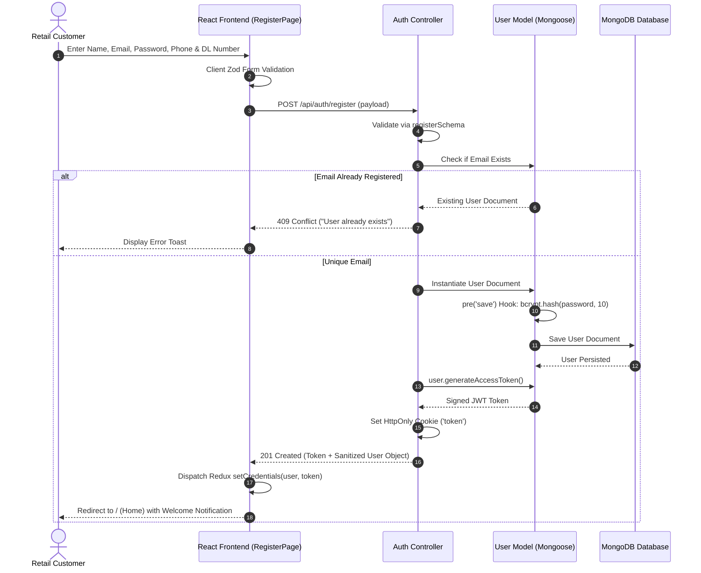
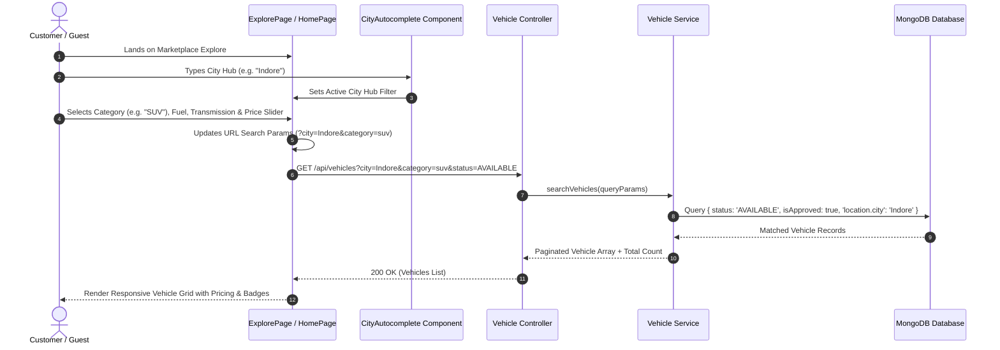
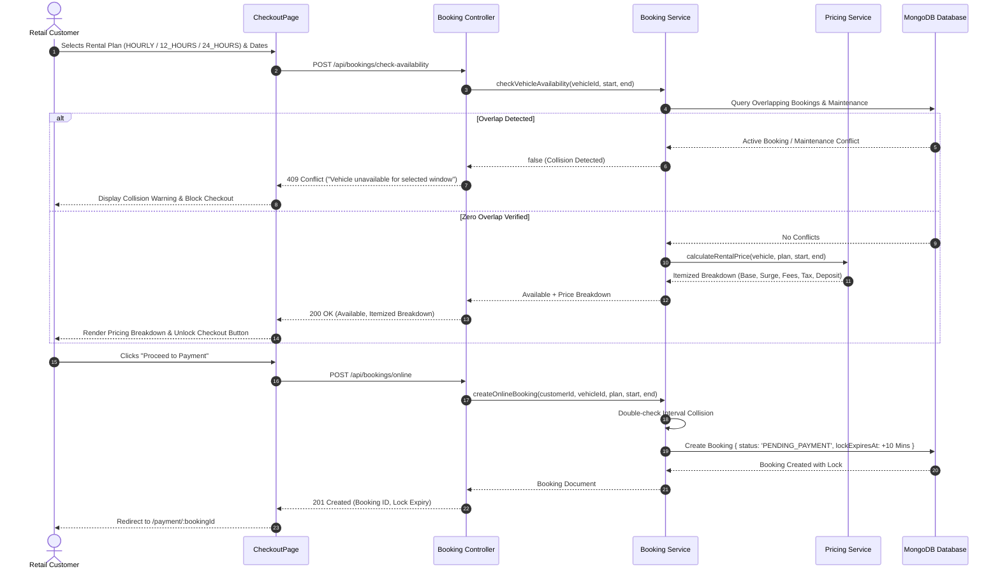
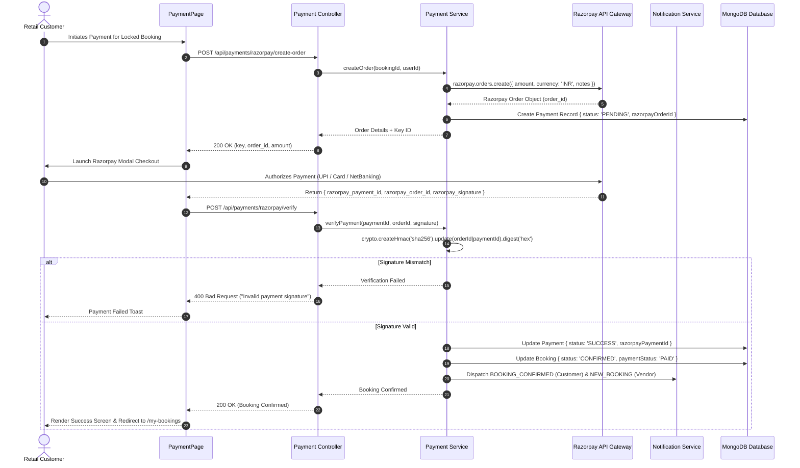
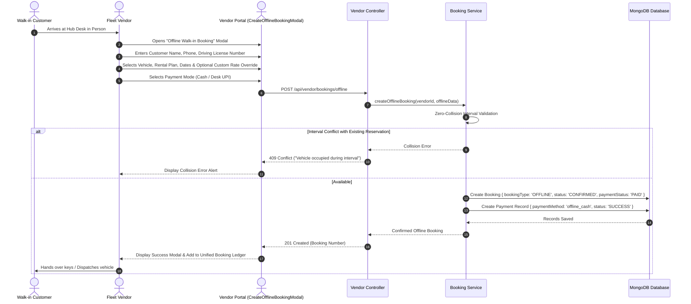
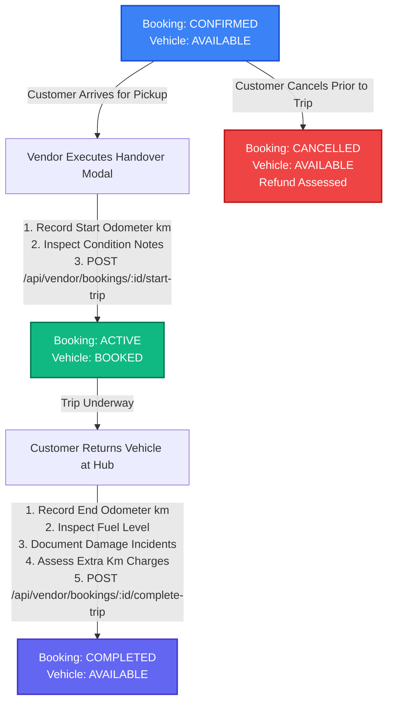
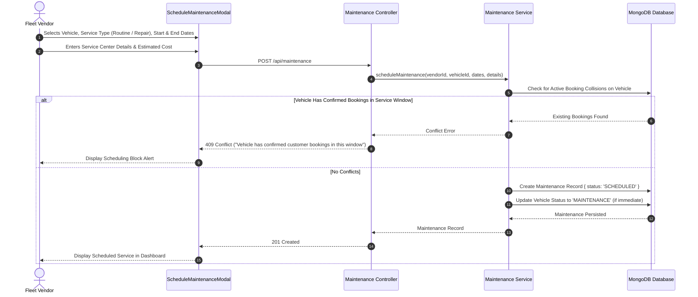
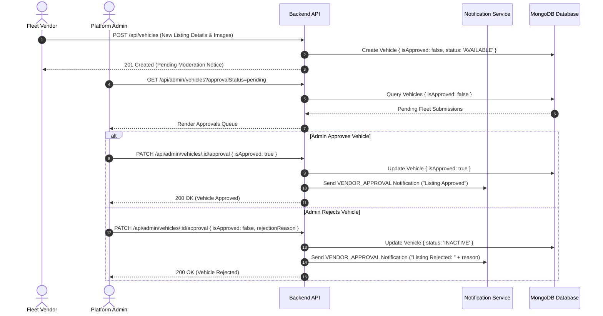
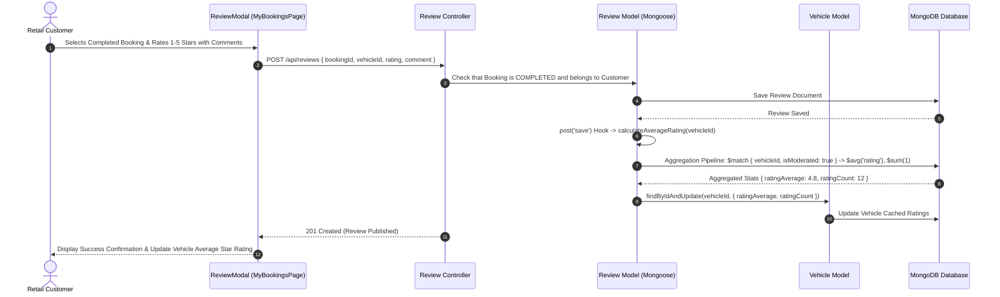

# 04 — User Journeys & End-to-End System Flows

> **Document Type:** Operational Workflows, User Journeys & Sequence Specifications  
> **Application:** RentRide Multi-Vendor Vehicle Rental Marketplace  
> **Status:** Verified from Live Implementation  
> **Version:** 1.3.0  
> **Date:** 2026-09-03  

---

## 1. Primary User Journey Flows

### 1.1 Customer Registration & Authentication Journey

---

### 1.2 Customer Vehicle Discovery & Search Journey

---

### 1.3 Online Booking & Anti-Collision Reservation Journey

---

### 1.4 Razorpay Payment & Confirmation Journey

---

### 1.5 Vendor Offline Walk-In Desk Dispatch Journey

---

### 1.6 Vehicle Handover & Trip Completion Lifecycle

---

### 1.7 Fleet Maintenance Scheduling Journey

---

### 1.8 Master Admin Vehicle Moderation Journey

---

### 1.9 Post-Trip Review & Rating Aggregation Journey

