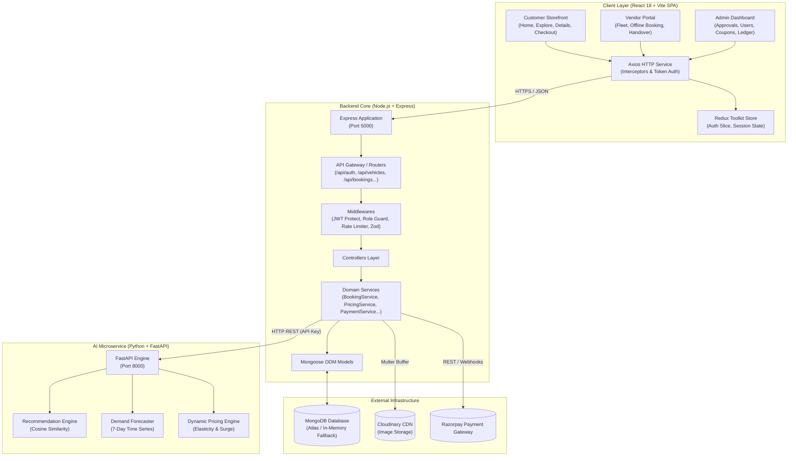
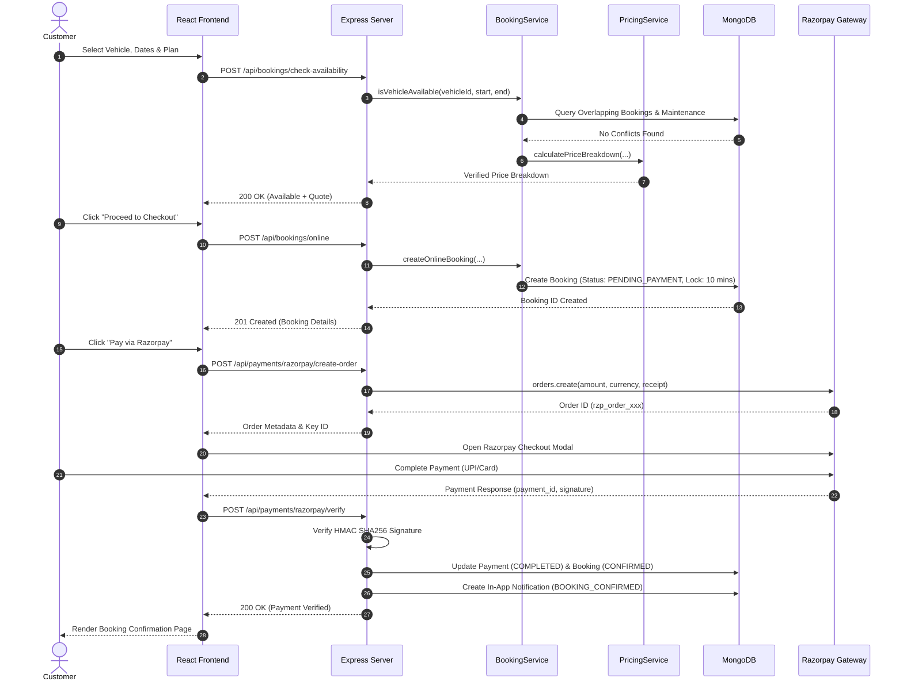

# 04 — System Architecture

This document describes the high-level architecture, module boundaries, data flows, and inter-service communication protocols across the RentRide platform.

---

## 1. High-Level Architecture

RentRide is built as a decoupled **Three-Tier System** with an auxiliary **Machine Learning Microservice**:



---

## 2. Frontend Architecture (React SPA)

The frontend is organized around modular layout shells and feature slices located under [`client/src/`](file:///c:/Users/vansh/OneDrive/Desktop/Project/RentRide/client/src):

```
client/src/
├── layouts/               # High-level UI shells
│   ├── CustomerLayout.jsx # Public storefront navbar + body + footer
│   ├── VendorLayout.jsx   # Dedicated vendor sidebar + header + workspace
│   ├── AdminLayout.jsx    # Dedicated admin sidebar + header + governance
│   └── Navbar.jsx / Footer.jsx
├── pages/                 # Route-level view components
│   ├── customer/          # HomePage, ExplorePage, VehicleDetailsPage, CheckoutPage...
│   ├── vendor/            # VendorDashboardPage, MyVehiclesPage
│   ├── admin/             # AdminDashboardPage
│   └── public/            # LoginPage, RegisterPage
├── features/              # Self-contained domain modules
│   ├── auth/              # LoginForm, RegisterForm, authSlice
│   ├── vehicles/          # VehicleCard, VehicleGrid, FilterPanel
│   ├── booking/           # PriceBreakdownCard
│   ├── vendor/            # AddVehicleModal, CreateOfflineBookingModal, VehicleHandoverModal
│   ├── admin/             # CouponManager
│   ├── ai/                # AiRecommendationsCarousel, DemandForecastWidget
│   ├── maintenance/       # ScheduleMaintenanceModal, CompleteMaintenanceModal
│   ├── notifications/     # NotificationDropdown
│   └── reviews/           # ReviewModal, VehicleReviewsList
├── components/            # Reusable UI primitives
│   ├── common/            # CityAutocomplete
│   └── navigation/        # ProtectedRoute, RoleRoute
├── services/              # Axios API clients for each resource
└── store/                 # Redux Toolkit store and root reducer
```

### Component Hierarchy & Routing
* **[`AppRoutes.jsx`](file:///c:/Users/vansh/OneDrive/Desktop/Project/RentRide/client/src/routes/AppRoutes.jsx)**: Defines public and role-protected routes using React Router DOM v7.
* **[`ProtectedRoute.jsx`](file:///c:/Users/vansh/OneDrive/Desktop/Project/RentRide/client/src/components/navigation/ProtectedRoute.jsx)**:
  * `ProtectedRoute`: Ensures the user possesses an active JWT authentication session.
  * `RoleRoute`: Validates that `user.role` matches the allowed role (`CUSTOMER`, `VENDOR`, `ADMIN`).

---

## 3. Backend Architecture (Layered Service Pattern)

The backend follows a strict **Layered Service Pattern** ensuring business logic is decoupled from HTTP transport:

```
HTTP Request
     ↓
[Express App & Global Middlewares] (Helmet, CORS, CookieParser, RateLimiter)
     ↓
[Domain Route Router] (e.g. /api/bookings)
     ↓
[Security & Validation Middleware] (protect, authorize, validate(ZodSchema))
     ↓
[Controller Layer] (Extracts params, invokes Service, formats ApiResponse)
     ↓
[Service Layer] (Zero-trust business logic, calculations, transactions, collisions)
     ↓
[Mongoose Models Layer] (Data modeling, schema validation, indexes, hooks)
     ↓
[MongoDB / External Services]
```

### Key Architectural Layers

1. **Routing & Dispatch ([`server/src/routes/`](file:///c:/Users/vansh/OneDrive/Desktop/Project/RentRide/server/src/routes/))**: Mounts domain routes and attaches middleware chains.
2. **Middleware Pipeline ([`server/src/middleware/`](file:///c:/Users/vansh/OneDrive/Desktop/Project/RentRide/server/src/middleware/))**:
   * `protect`: Verifies JWT from `Authorization: Bearer <token>` or `req.cookies.rentride_token`.
   * `authorize(...roles)`: Enforces role permissions.
   * `validate(schema)`: Validates `req.body`, `req.query`, or `req.params` against strict Zod schemas.
   * `upload`: Handles multipart image buffers in memory via Multer.
   * `errorHandler`: Formats unhandled exceptions into uniform JSON `ApiError` responses.
3. **Controller Layer ([`server/src/controllers/`](file:///c:/Users/vansh/OneDrive/Desktop/Project/RentRide/server/src/controllers/))**: Wraps async methods with `asyncHandler`, receives HTTP input, calls domain services, and returns standardized `ApiResponse(status, data, message)`.
4. **Service Layer ([`server/src/services/`](file:///c:/Users/vansh/OneDrive/Desktop/Project/RentRide/server/src/services/))**: Encapsulates core business algorithms:
   * [`BookingService`](file:///c:/Users/vansh/OneDrive/Desktop/Project/RentRide/server/src/services/booking.service.js): Interval overlap collision detection, locking, offline customer logging, handover, and cancellation.
   * [`PricingService`](file:///c:/Users/vansh/OneDrive/Desktop/Project/RentRide/server/src/services/pricing.service.js): Server-side rate calculation, surge pricing, coupon validation, GST, and commission splits.
   * [`PaymentService`](file:///c:/Users/vansh/OneDrive/Desktop/Project/RentRide/server/src/services/payment.service.js): Razorpay order generation and HMAC SHA256 signature verification.
   * [`VehicleService`](file:///c:/Users/vansh/OneDrive/Desktop/Project/RentRide/server/src/services/vehicle.service.js): Search filter aggregation, Cloudinary upload pipeline, and fleet state.
   * [`AiService`](file:///c:/Users/vansh/OneDrive/Desktop/Project/RentRide/server/src/services/ai.service.js): Internal proxy connecting Express to the Python FastAPI microservice.

---

## 4. End-to-End Data Flow

### A. Customer Booking & Payment Lifecycle



---

## 5. Authentication & Session Architecture

```mermaid
flowchart LR
    User([User Credentials]) -->|POST /api/auth/login| Server[Express Auth Controller]
    Server -->|bcrypt.compare| DB[(User Collection)]
    DB -->|Valid| Server
    Server -->|Sign JWT with 7d Expiry| Token[JWT Access Token]
    Token -->|Set-Cookie: rentride_token| CookieStorage[HttpOnly Cookie]
    Token -->|JSON Body { token, user }| LocalStorage[Client LocalStorage]

    LocalStorage -->|Authorization: Bearer Token| Axios[Axios Request Interceptor]
    CookieStorage -->|withCredentials: true| Axios
    Axios -->|Authenticated Request| ProtectedEndpoints[Protected Route / Middleware]
```

---

## 6. AI Microservice Architecture

The Python microservice located at [`ai-service/`](file:///c:/Users/vansh/OneDrive/Desktop/Project/RentRide/ai-service) runs independently on port `8000` via FastAPI and Uvicorn:

* **Endpoint Routing ([`api_router.py`](file:///c:/Users/vansh/OneDrive/Desktop/Project/RentRide/ai-service/app/api/v1/api_router.py))**:
  * `POST /api/v1/recommendations`: Ingests candidate vehicle listings and customer preferences; vectorizes category, rating, and seating attributes; executes cosine similarity scoring and returns top-N ranked vehicles.
  * `POST /api/v1/demand-forecast`: Generates 7-day predictive demand indices based on city, category, and historical fleet utilization heuristics.
  * `POST /api/v1/dynamic-pricing`: Evaluates current booking date, day-of-week, seasonal modifiers, and fleet utilization to output dynamic surge multipliers.
* **Security ([`security.py`](file:///c:/Users/vansh/OneDrive/Desktop/Project/RentRide/ai-service/app/core/security.py))**: Requires valid `X-API-Key` header matching `AI_SERVICE_API_KEY` configured in [`server/.env`](file:///c:/Users/vansh/OneDrive/Desktop/Project/RentRide/server/.env#L26).
