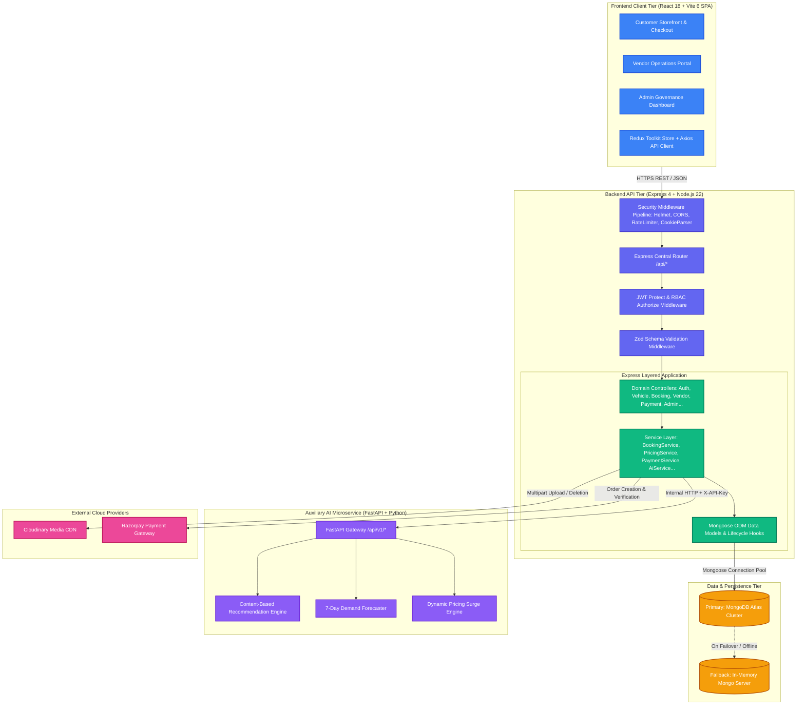

# 05 — System Architecture & Engineering Design

> **Document Type:** Multi-Tier System Architecture & Subsystem Specification  
> **Application:** RentRide Multi-Vendor Vehicle Rental Marketplace  
> **Status:** Verified from Live Implementation  
> **Version:** 1.3.0  
> **Date:** 2026-09-03  

---

## 1. High-Level Architecture Overview

RentRide is engineered as a **distributed, multi-tier, microservice-augmented web application**. The primary system consists of three cohesive tiers:
1. **Client Tier:** A single-page application (SPA) built with React 18, Vite 6, Tailwind CSS, and Redux Toolkit.
2. **Backend API Tier:** A modular RESTful application server developed in Node.js (ES Modules) using Express 4, organized according to a strict **Layered Controller-Service-Repository** pattern.
3. **Auxiliary AI Microservice Tier:** A Python 3 / FastAPI microservice delivering machine learning capabilities (content-based vehicle recommendations, 7-day demand forecasting, dynamic pricing calculation) secured via service-to-service API key authentication.
4. **Data & Storage Tier:** A document datastore managed via Mongoose ODM connecting to MongoDB Atlas (with an automated in-memory fallback), paired with Cloudinary CDN for media asset storage and Razorpay for payment orchestration.

---

## 2. Mermaid System Architecture Diagram

---

## 3. Subsystem Breakdown

### 3.1 Frontend Client Tier
* **Build Engine:** Vite 6 delivering optimized ES Module development server and tree-shaken production bundles.
* **UI Framework:** React 18 with modern functional components and hooks.
* **Routing Architecture:** React Router v7 (`AppRoutes.jsx`) utilizing nested layout routes (`CustomerLayout`, `VendorLayout`, `AdminLayout`) and declarative route guards (`ProtectedRoute`, `RoleRoute`).
* **State Management:** Redux Toolkit (`authSlice.js`) maintaining persistent authentication tokens, user profile metadata, and active role contexts synchronized with `localStorage`.
* **Styling & Icons:** Tailwind CSS 3.4 utility classes paired with `lucide-react` and `react-icons` for unified typography and iconography.
* **Forms & Validation:** `react-hook-form` coupled with `@hookform/resolvers/zod` for client-side form validation before dispatch.
* **Data Visualization:** `recharts` for rendering interactive operational metrics, fleet utilization curves, and financial charts.

### 3.2 Backend API Tier (Layered Architecture)
The backend adheres to a strict separation of concerns across distinct layers:
1. **Routing Layer (`server/src/routes/`):** Mounts endpoints, establishes HTTP verbs, and chains middleware guards.
2. **Middleware Pipeline (`server/src/middleware/`):**
   * `helmet`: Injects defensive HTTP response security headers.
   * `cors`: Controls origin whitelisting (`CLIENT_URL`).
   * `rateLimiter.middleware.js`: Protects auth routes (`10 req / 15 min`) and general routes (`200 req / 15 min`).
   * `auth.middleware.js` (`protect`): Verifies JWT tokens from Authorization headers and cookies.
   * `role.middleware.js` (`authorize`): Enforces RBAC permissions.
   * `validate.middleware.js` (`validate`): Validates request body, query, and params against Zod schemas.
   * `upload.middleware.js`: Processes multipart file uploads in memory for Cloudinary dispatch.
   * `error.middleware.js`: Formats unexpected exceptions into uniform `ApiResponse` / `ApiError` payloads.
3. **Controller Layer (`server/src/controllers/`):** Unpacks HTTP requests, extracts parameters, invokes services, and formats standard JSON responses.
4. **Service Layer (`server/src/services/`):** Encapsulates core business rules (anti-collision interval checks, dynamic price calculation, payout splits, coupon validation).
5. **Model / Data Access Layer (`server/src/models/`):** Manages Mongoose schemas, compound indexes, and pre/post lifecycle hooks.

### 3.3 Data & Persistence Tier
* **Primary Database:** MongoDB Atlas hosted replica set connected via connection pooling (`mongoose.connect`).
* **Resilient In-Memory Fallback:** Implemented in [`server/src/config/db.js`](file:///c:/Users/vansh/OneDrive/Desktop/Project/RentRide/server/src/config/db.js). If `MONGODB_URI` is unreachable or unconfigured, the server automatically spawns an embedded `mongodb-memory-server` and executes an automated database seeder (`seedData()`) populating default categories, test users (Customer, Vendor, Admin), and sample vehicle fleets across all operating hubs.

### 3.4 AI & Machine Learning Microservice Tier
* **Framework:** Python 3 + FastAPI.
* **Data Validation:** Pydantic v2 schemas (`RecommendationRequest`, `DemandForecastRequest`, `DynamicPricingRequest`).
* **Security:** Enforces `X-API-Key` header matching `settings.AI_SERVICE_API_KEY`.
* **Algorithms:**
  * **Vehicle Recommendations (`recommendation_engine.py`):** Multi-attribute scoring algorithm weighing category similarity (40%), price tolerance (25%), fuel/transmission fit (20%), and vehicle rating/popularity (15%).
  * **Demand Forecasting (`demand_forecaster.py`):** Time-series heuristic model assessing day-of-week seasonality (Friday–Sunday peaks), city multiplier indices (Indore: 1.1x, Bhopal: 1.05x, Gwalior: 1.0x), and current fleet utilization pressure.
  * **Dynamic Pricing Engine (`dynamic_pricing_engine.py`):** Elastic rate calculation applying scarcity surges when utilization exceeds 75% and weekend demand surges (+15%), capped between 0.90x and 1.35x.
* **Resilience:** The Node.js backend's [`ai.service.js`](file:///c:/Users/vansh/OneDrive/Desktop/Project/RentRide/server/src/services/ai.service.js) wraps microservice HTTP calls in try/catch blocks; if the Python service is offline, it automatically executes local Node.js heuristic fallback algorithms, ensuring zero frontend degradation.

### 3.5 External Integrations
* **Cloudinary CDN (`cloudinary.js`):** Direct buffer stream upload for user avatars and multi-image vehicle listing galleries; executes asset deletion upon vehicle removal.
* **Razorpay Gateway (`razorpay.js`):** Server-side order creation in INR currency; cryptographic HMAC-SHA256 signature verification upon checkout completion.

---

## 4. Network & Communication Protocols

| Source | Destination | Protocol | Authentication / Security |
| :--- | :--- | :--- | :--- |
| Client (Browser) | Express Backend | HTTPS / REST (JSON) | JWT Bearer Token / HttpOnly Cookie |
| Express Backend | MongoDB Atlas | MongoDB Wire Protocol | TLS 1.3 + SCRAM-SHA-256 Auth |
| Express Backend | AI Microservice | HTTP / REST (JSON) | `X-API-Key` Shared Secret Header |
| Express Backend | Cloudinary CDN | HTTPS REST API | API Key + API Secret Signed Stream |
| Express Backend | Razorpay Gateway | HTTPS REST API | Basic Auth (`key_id` + `key_secret`) |
| Client (Browser) | Razorpay Checkout | HTTPS (Iframe Modal) | Publishable Razorpay Key ID |

---

## 5. Environment Configuration Specifications

### Backend Environment Variables (`server/.env.example`)
* `PORT`: Server listening port (default: `5000`)
* `NODE_ENV`: Runtime mode (`development` / `production`)
* `MONGODB_URI`: MongoDB Atlas connection string
* `CLIENT_URL`: Allowed CORS origin (default: `http://localhost:5173`)
* `JWT_SECRET`: Secret key for signing JWT tokens
* `JWT_EXPIRES_IN`: Token validity duration (default: `7d`)
* `CLOUDINARY_CLOUD_NAME`, `CLOUDINARY_API_KEY`, `CLOUDINARY_API_SECRET`: Media CDN credentials
* `RAZORPAY_KEY_ID`, `RAZORPAY_KEY_SECRET`: Razorpay payment gateway credentials
* `AI_SERVICE_URL`: Base URL for FastAPI microservice (default: `http://localhost:8000/api/v1`)
* `AI_SERVICE_API_KEY`: Shared secret key for internal AI microservice communication

### Client Environment Variables (`client/.env.example`)
* `VITE_API_BASE_URL`: Express backend base URL (default: `http://localhost:5000/api`)
* `VITE_RAZORPAY_KEY_ID`: Razorpay publishable client key

### AI Service Environment Variables (`ai-service/.env.example`)
* `HOST`: Microservice host binding (default: `0.0.0.0`)
* `PORT`: Microservice port (default: `8000`)
* `AI_SERVICE_API_KEY`: API key required in `X-API-Key` request header
