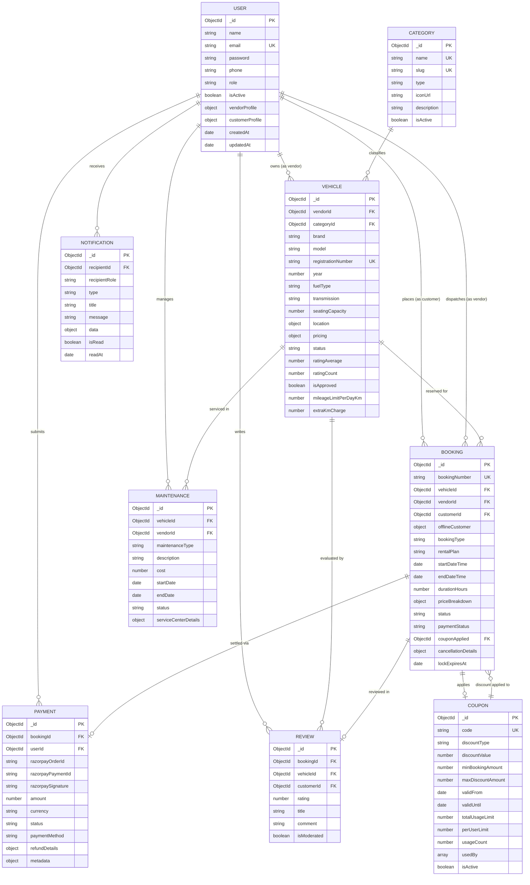

# 06 — Database Design & Schema Specification

> **Document Type:** Database Architecture, Entity-Relationship Models & Indexing Specification  
> **Application:** RentRide Multi-Vendor Vehicle Rental Marketplace  
> **Status:** Verified from Live Implementation  
> **Version:** 1.3.0  
> **Date:** 2026-09-03  

---

## 1. Database Architecture Overview

RentRide utilizes a document-oriented datastore managed through **Mongoose 8 ODM** connecting to MongoDB. The data model is optimized for high-read marketplace catalog searches, atomic reservation state transitions, and high-frequency collision detection queries.

The database consists of **9 operational collections**:
1. `users`: Identity, authentication credentials, role flags, and customer/vendor profiles.
2. `categories`: Vehicle classification metadata (two-wheeler / four-wheeler).
3. `vehicles`: Fleet listings, technical specifications, tiered rates, locations, and cached rating aggregates.
4. `bookings`: Rental contracts, anti-collision intervals, itemized price breakdowns, and state machines.
5. `payments`: Payment gateway transaction logs, Razorpay signatures, and refund states.
6. `coupons`: Promotional discount rules, usage limits, and redemption histories.
7. `reviews`: Verified post-trip customer feedback and star ratings.
8. `notifications`: In-app lifecycle alerts, read receipts, and notification types.
9. `maintenances`: Fleet servicing downtime blocks, costs, and garage logs.

---

## 2. Mermaid Entity-Relationship (ER) Diagram

---

## 3. Detailed Collection Schemas

### 3.1 Collection: `users`
* **File:** [`server/src/models/user.model.js`](file:///c:/Users/vansh/OneDrive/Desktop/Project/RentRide/server/src/models/user.model.js)
* **Purpose:** Core user identity, role definitions, and role-specific profile extensions.

| Field | Type | Required | Default | Validation / Constraints | Description |
| :--- | :--- | :---: | :---: | :--- | :--- |
| `_id` | ObjectId | Yes | Auto | Unique MongoDB Identifier | Primary Key |
| `name` | String | Yes | — | Min 2, Max 60 chars, trimmed | Full user name |
| `email` | String | Yes | — | Unique, lowercase, valid email regex | User email address |
| `password` | String | Yes | — | Min 6 chars, `select: false` | Bcrypt hashed password |
| `phone` | String | No | `""` | Trimmed | Contact mobile number |
| `role` | String | Yes | `CUSTOMER` | Enum: `['CUSTOMER', 'VENDOR', 'ADMIN']` | Role for RBAC authorization |
| `avatar` | Object | No | `{}` | `url`: String, `publicId`: String | Cloudinary avatar image metadata |
| `isActive` | Boolean | Yes | `true` | — | Account active/disabled status |
| `vendorProfile.businessName` | String | No | `""` | Trimmed | Registered vendor trade name |
| `vendorProfile.gstNumber` | String | No | `""` | Uppercase, trimmed | Vendor GST tax identification |
| `vendorProfile.address` | Object | No | `{}` | `street`, `city`, `state`, `pincode` | Vendor hub operational address |
| `vendorProfile.isApproved` | Boolean | Yes | `false` | — | Admin verification flag for vendor |
| `vendorProfile.commissionRateOverride` | Number | No | `null` | — | Custom negotiated platform commission |
| `customerProfile.drivingLicenseNumber` | String | No | `""` | Uppercase, trimmed | Customer Driving License identifier |
| `customerProfile.drivingLicenseUrl` | String | No | `""` | URL string | Cloudinary URL of uploaded DL document |
| `customerProfile.kycStatus` | String | Yes | `PENDING` | Enum: `['PENDING', 'VERIFIED', 'REJECTED']` | Customer verification state |
| `createdAt`, `updatedAt` | Date | Yes | Auto | Managed by Mongoose timestamps | Audit timestamps |

* **Indexes:**
  * `{ email: 1, role: 1 }` (Compound login query optimization)
* **Hooks & Methods:**
  * `pre('save')`: Hashes `password` using `bcrypt.genSalt(10)` if modified.
  * `methods.isPasswordCorrect(candidatePassword)`: Returns boolean comparison via `bcrypt.compare`.
  * `methods.generateAccessToken()`: Returns signed JWT with `_id, email, name, role`.

---

### 3.2 Collection: `categories`
* **File:** [`server/src/models/category.model.js`](file:///c:/Users/vansh/OneDrive/Desktop/Project/RentRide/server/src/models/category.model.js)
* **Purpose:** Vehicle classification taxonomy.

| Field | Type | Required | Default | Validation / Constraints | Description |
| :--- | :--- | :---: | :---: | :--- | :--- |
| `_id` | ObjectId | Yes | Auto | Unique identifier | Primary Key |
| `name` | String | Yes | — | Unique, max 50 chars, trimmed | Category name (e.g. "SUV") |
| `slug` | String | Yes | Auto | Unique, lowercase, slugified | URL-safe slug (e.g. "suv") |
| `type` | String | Yes | — | Enum: `['two_wheeler', 'four_wheeler']` | Broad vehicle class |
| `iconUrl` | String | No | `""` | Image / SVG URL | Category display icon |
| `description` | String | No | `""` | Trimmed | Category marketing description |
| `isActive` | Boolean | Yes | `true` | — | Visible in public marketplace |

* **Hooks:**
  * `pre('validate')`: Automatically generates kebab-cased `slug` from `name` if not supplied.

---

### 3.3 Collection: `vehicles`
* **File:** [`server/src/models/vehicle.model.js`](file:///c:/Users/vansh/OneDrive/Desktop/Project/RentRide/server/src/models/vehicle.model.js)
* **Purpose:** Fleet inventory records, specifications, tiered pricing, and status.

| Field | Type | Required | Default | Validation / Constraints | Description |
| :--- | :--- | :---: | :---: | :--- | :--- |
| `_id` | ObjectId | Yes | Auto | Unique identifier | Primary Key |
| `vendorId` | ObjectId | Yes | — | Ref: `User` | Owning vendor entity |
| `categoryId` | ObjectId | Yes | — | Ref: `Category` | Vehicle category reference |
| `brand` | String | Yes | — | Trimmed | Manufacturer (e.g. "Tata", "Royal Enfield") |
| `model` | String | Yes | — | Trimmed | Model name (e.g. "Nexon EV", "Hunter 350") |
| `registrationNumber` | String | Yes | — | Unique, uppercase, trimmed | Official vehicle license plate |
| `year` | Number | Yes | — | Min 2000, Max currentYear + 1 | Year of manufacture |
| `fuelType` | String | Yes | — | Enum: `['petrol', 'diesel', 'electric', 'cng', 'hybrid']` | Fuel / propulsion type |
| `transmission` | String | Yes | — | Enum: `['manual', 'automatic']` | Gear transmission type |
| `seatingCapacity` | Number | Yes | — | Min 1 | Passenger seating capacity |
| `engineCapacity` | Number | No | `null` | — | Engine displacement (cc) or EV battery (kWh) |
| `location.city` | String | Yes | — | Trimmed | Operating hub city (Indore, Bhopal, Gwalior) |
| `location.state` | String | No | `""` | Trimmed | State name (Madhya Pradesh) |
| `location.address` | String | No | `""` | Trimmed | Physical pickup hub street address |
| `location.coordinates` | Object | No | `{lat: 0, lng: 0}` | Numbers | Geolocation coordinates |
| `images` | Array | Yes | `[]` | Object: `{ url, publicId, isPrimary }` | Multi-image gallery stored on Cloudinary |
| `features` | Array | No | `[]` | Array of strings | Feature badges (ABS, Bluetooth, Helmets) |
| `pricing.hourlyRate` | Number | Yes | — | Min ₹10 | Base rate per hour for flexible trips |
| `pricing.rate12Hour` | Number | Yes | — | Min ₹50 | Fixed rate for 12-hour day rentals |
| `pricing.rate24Hour` | Number | Yes | — | Min ₹100 | Fixed rate for 24-hour full-day rentals |
| `pricing.minRentalHours` | Number | Yes | `1` | Min 1 | Minimum rental duration threshold |
| `pricing.securityDeposit` | Number | Yes | `1000` | Min 0 | Refundable security deposit amount |
| `status` | String | Yes | `AVAILABLE` | Enum: `['AVAILABLE', 'BOOKED', 'MAINTENANCE', 'INACTIVE']` | Live operational availability |
| `ratingAverage` | Number | Yes | `0` | Min 0, Max 5, rounded to 1 dec | Aggregated customer star rating |
| `ratingCount` | Number | Yes | `0` | Min 0 | Total number of approved reviews |
| `isApproved` | Boolean | Yes | `true` | — | Master admin moderation approval flag |
| `mileageLimitPerDayKm` | Number | Yes | `250` | Min 0 | Daily included kilometer allowance |
| `extraKmCharge` | Number | Yes | `10` | Min 0 | Overage penalty rate per kilometer |
| `fuelEconomy` | Number | No | `null` | Min 0.1 | Certified fuel economy or EV range |
| `fuelEconomyUnit` | String | No | `'km/l'` | Enum: `['km/l', 'km/kg', 'km/charge']` | Mileage measurement unit |

* **Indexes:**
  * `{ categoryId: 1, status: 1, isApproved: 1 }` (Primary marketplace filter index)
  * `{ 'location.city': 1, status: 1 }` (Hub search index)
  * `{ vendorId: 1, status: 1 }` (Vendor fleet management index)
  * `{ brand: 1, model: 1 }` (Keyword search index)
  * `{ 'pricing.hourlyRate': 1 }` (Price sorting index)

---

### 3.4 Collection: `bookings`
* **File:** [`server/src/models/booking.model.js`](file:///c:/Users/vansh/OneDrive/Desktop/Project/RentRide/server/src/models/booking.model.js)
* **Purpose:** Rental contracts, anti-collision intervals, and state machines.

| Field | Type | Required | Default | Validation / Constraints | Description |
| :--- | :--- | :---: | :---: | :--- | :--- |
| `_id` | ObjectId | Yes | Auto | Unique identifier | Primary Key |
| `bookingNumber` | String | Yes | Auto | Unique, uppercase, formatted `RR-YYYYMMDD-XXXXX` | Human-readable tracking number |
| `vehicleId` | ObjectId | Yes | — | Ref: `Vehicle` | Reserved vehicle entity |
| `vendorId` | ObjectId | Yes | — | Ref: `User` | Vehicle fleet owner |
| `customerId` | ObjectId | No | `null` | Ref: `User` | Renter user (null for walk-ins) |
| `offlineCustomer` | Object | No | `{}` | `name, phone, drivingLicenseNumber, notes` | Walk-in customer metadata |
| `bookingType` | String | Yes | `ONLINE` | Enum: `['ONLINE', 'OFFLINE']` | Booking acquisition channel |
| `rentalPlan` | String | Yes | — | Enum: `['HOURLY', '12_HOURS', '24_HOURS']` | Selected pricing tier |
| `startDateTime` | Date | Yes | — | Valid Date | Rental interval start timestamp |
| `endDateTime` | Date | Yes | — | Must be greater than `startDateTime` | Rental interval return timestamp |
| `durationHours` | Number | Yes | — | Min 1 | Total rental duration in hours |
| `priceBreakdown.basePrice` | Number | Yes | — | — | Base vehicle rental rate |
| `priceBreakdown.surgeMultiplier`| Number | Yes | `1.0` | — | Weekend (1.15x) or dynamic multiplier |
| `priceBreakdown.couponDiscount` | Number | Yes | `0` | — | Promotional discount deducted |
| `priceBreakdown.subtotal` | Number | Yes | — | — | Base rate after surge minus coupon |
| `priceBreakdown.platformFee` | Number | Yes | — | 5% of subtotal | Customer marketplace service fee |
| `priceBreakdown.taxAmount` | Number | Yes | — | 18% GST on subtotal + platform fee | Government tax levy |
| `priceBreakdown.securityDeposit`| Number | Yes | — | Refundable | Vehicle security deposit hold |
| `priceBreakdown.totalAmount` | Number | Yes | — | Subtotal + Fee + Tax + Deposit | Gross invoice amount paid by customer |
| `priceBreakdown.vendorPayout` | Number | Yes | — | 88% of subtotal + Deposit | Net amount owed to vendor |
| `priceBreakdown.platformCommission`| Number | Yes | — | 12% of subtotal + Fee + Tax | Net revenue retained by platform |
| `status` | String | Yes | `PENDING_PAYMENT` | Enum: `['PENDING_PAYMENT', 'CONFIRMED', 'ACTIVE', 'COMPLETED', 'CANCELLED']` | Lifecycle state machine |
| `paymentStatus` | String | Yes | `PENDING` | Enum: `['PENDING', 'PAID', 'FAILED', 'REFUNDED']` | Financial settlement status |
| `couponApplied` | ObjectId | No | `null` | Ref: `Coupon` | Redeemed coupon reference |
| `cancellationDetails` | Object | No | `{}` | `cancelledBy, reason, cancelledAt, refundAmount, cancellationFee` | Cancellation audit details |
| `lockExpiresAt` | Date | Yes | `+10 Mins` | Date timestamp | Temporary reservation lock TTL |

* **Indexes (Critical Collision Prevention):**
  * `{ vehicleId: 1, startDateTime: 1, endDateTime: 1, status: 1 }` (Anti-collision query index)
  * `{ customerId: 1, createdAt: -1 }` (Customer booking history index)
  * `{ vendorId: 1, startDateTime: -1 }` (Vendor operations schedule index)
  * `{ status: 1, lockExpiresAt: 1 }` (Hold lock TTL expiry scan index)

---

### 3.5 Collection: `payments`
* **File:** [`server/src/models/payment.model.js`](file:///c:/Users/vansh/OneDrive/Desktop/Project/RentRide/server/src/models/payment.model.js)
* **Purpose:** Financial transactions, payment gateway verification, and refunds.

| Field | Type | Required | Default | Validation / Constraints | Description |
| :--- | :--- | :---: | :---: | :--- | :--- |
| `_id` | ObjectId | Yes | Auto | Unique identifier | Primary Key |
| `bookingId` | ObjectId | Yes | — | Ref: `Booking` | Associated booking contract |
| `userId` | ObjectId | No | `null` | Ref: `User` | Payer user entity |
| `razorpayOrderId` | String | No | `null` | Trimmed | Razorpay order identifier (`order_...`) |
| `razorpayPaymentId` | String | No | `null` | Trimmed | Razorpay payment identifier (`pay_...`) |
| `razorpaySignature` | String | No | `null` | Trimmed | Cryptographic HMAC-SHA256 signature |
| `amount` | Number | Yes | — | Min 0 | Total paid in INR |
| `currency` | String | Yes | `INR` | Uppercase | Currency ISO code |
| `status` | String | Yes | `PENDING` | Enum: `['PENDING', 'SUCCESS', 'FAILED', 'REFUNDED']` | Transaction state |
| `paymentMethod` | String | Yes | `other` | Enum: `['card', 'upi', 'netbanking', 'wallet', 'offline_cash', 'other']` | Payment channel |
| `refundDetails` | Object | No | `{}` | `refundId, amount, status, reason, processedAt` | Gateway refund details |

* **Indexes:**
  * `{ bookingId: 1 }`, `{ razorpayOrderId: 1 }`, `{ razorpayPaymentId: 1 }`, `{ userId: 1, createdAt: -1 }`

---

### 3.6 Collection: `coupons`
* **File:** [`server/src/models/coupon.model.js`](file:///c:/Users/vansh/OneDrive/Desktop/Project/RentRide/server/src/models/coupon.model.js)
* **Purpose:** Promotional discounts and usage tracking.

| Field | Type | Required | Default | Validation / Constraints | Description |
| :--- | :--- | :---: | :---: | :--- | :--- |
| `_id` | ObjectId | Yes | Auto | Unique identifier | Primary Key |
| `code` | String | Yes | — | Unique, uppercase, trimmed | Promo voucher code (e.g. "WELCOME50") |
| `discountType` | String | Yes | — | Enum: `['PERCENTAGE', 'FIXED']` | Discount calculation mode |
| `discountValue` | Number | Yes | — | Min 1 | Discount percentage (e.g. 20) or fixed ₹ |
| `minBookingAmount` | Number | Yes | `0` | Min 0 | Minimum cart subtotal required |
| `maxDiscountAmount`| Number | No | `null` | Cap for percentage discounts | Maximum discount ceiling |
| `validFrom`, `validUntil` | Date | Yes | — | Expiry must be in future | Active validity window |
| `totalUsageLimit` | Number | Yes | `500` | Min 1 | Maximum redemptions platform-wide |
| `perUserLimit` | Number | Yes | `1` | Min 1 | Max redemptions allowed per user |
| `usageCount` | Number | Yes | `0` | Incremented on booking confirmation | Current total redemptions |
| `usedBy` | Array | No | `[]` | Array: `{ userId, bookingId, usedAt }` | Redemption audit trail |
| `isActive` | Boolean | Yes | `true` | — | Promotional coupon active flag |

---

### 3.7 Collection: `reviews`
* **File:** [`server/src/models/review.model.js`](file:///c:/Users/vansh/OneDrive/Desktop/Project/RentRide/server/src/models/review.model.js)
* **Purpose:** Verified customer ratings and feedback.

| Field | Type | Required | Default | Validation / Constraints | Description |
| :--- | :--- | :---: | :---: | :--- | :--- |
| `_id` | ObjectId | Yes | Auto | Unique identifier | Primary Key |
| `bookingId` | ObjectId | Yes | — | Ref: `Booking`, unique per review | Associated completed rental trip |
| `vehicleId` | ObjectId | Yes | — | Ref: `Vehicle` | Evaluated vehicle entity |
| `customerId` | ObjectId | Yes | — | Ref: `User` | Renter author entity |
| `rating` | Number | Yes | — | Min 1, Max 5, integer | Star rating evaluation |
| `title` | String | No | `""` | Trimmed | Short review summary |
| `comment` | String | Yes | — | Trimmed | Detailed written customer feedback |
| `isModerated` | Boolean | Yes | `true` | — | Review visibility moderation flag |

* **Hooks:**
  * `post('save')` & `post('findOneAndDelete')`: Automatically invokes `calculateAverageRating(vehicleId)` which runs an aggregation pipeline computing `$avg('rating')` and `$sum(1)` on approved reviews, updating `Vehicle.ratingAverage` and `Vehicle.ratingCount` atomically.

---

### 3.8 Collection: `maintenances`
* **File:** [`server/src/models/maintenance.model.js`](file:///c:/Users/vansh/OneDrive/Desktop/Project/RentRide/server/src/models/maintenance.model.js)
* **Purpose:** Fleet servicing, repair schedules, and vehicle availability blockouts.

| Field | Type | Required | Default | Validation / Constraints | Description |
| :--- | :--- | :---: | :---: | :--- | :--- |
| `_id` | ObjectId | Yes | Auto | Unique identifier | Primary Key |
| `vehicleId` | ObjectId | Yes | — | Ref: `Vehicle` | Vehicle undergoing maintenance |
| `vendorId` | ObjectId | Yes | — | Ref: `User` | Operating fleet vendor |
| `maintenanceType`| String | Yes | `routine` | Enum: `['routine', 'repair', 'inspection', 'accident', 'cleaning']` | Service classification |
| `description` | String | Yes | — | Trimmed | Description of service work |
| `cost` | Number | Yes | `0` | Min 0 | Service expense incurred in INR |
| `startDate`, `endDate` | Date | Yes | — | End must be after start | Scheduled service window |
| `status` | String | Yes | `SCHEDULED` | Enum: `['SCHEDULED', 'IN_PROGRESS', 'COMPLETED', 'CANCELLED']` | Service state |
| `serviceCenterDetails` | Object | No | `{}` | `name, contact, invoiceUrl` | Garage / workshop contact details |

* **Indexes:**
  * `{ vehicleId: 1, startDate: 1, endDate: 1, status: 1 }` (Critical collision blocking index)

---

### 3.9 Collection: `notifications`
* **File:** [`server/src/models/notification.model.js`](file:///c:/Users/vansh/OneDrive/Desktop/Project/RentRide/server/src/models/notification.model.js)
* **Purpose:** Asynchronous user alerts and lifecycle communication.

| Field | Type | Required | Default | Validation / Constraints | Description |
| :--- | :--- | :---: | :---: | :--- | :--- |
| `_id` | ObjectId | Yes | Auto | Unique identifier | Primary Key |
| `recipientId` | ObjectId | Yes | — | Ref: `User` | Target recipient user |
| `recipientRole`| String | Yes | — | Enum: `['CUSTOMER', 'VENDOR', 'ADMIN']` | Role of recipient |
| `type` | String | Yes | `SYSTEM_ANNOUNCEMENT` | Enum: `['BOOKING_CONFIRMED', 'BOOKING_CANCELLED', 'PAYMENT_SUCCESS', 'PAYMENT_FAILED', 'MAINTENANCE_ALERT', 'VENDOR_APPROVAL', 'REVIEW_RECEIVED', 'SYSTEM_ANNOUNCEMENT']` | Categorical alert type |
| `title` | String | Yes | — | Trimmed | Notification headline |
| `message` | String | Yes | — | Trimmed | Full notification body text |
| `data` | Mixed | No | `{}` | Key-value pairs | Contextual references (e.g. `bookingId`) |
| `isRead` | Boolean | Yes | `false` | — | Read receipt status |
| `readAt` | Date | No | `null` | Timestamp | Timestamp when marked as read |

* **Indexes:**
  * `{ recipientId: 1, isRead: 1, createdAt: -1 }` (User notification dropdown query index)
