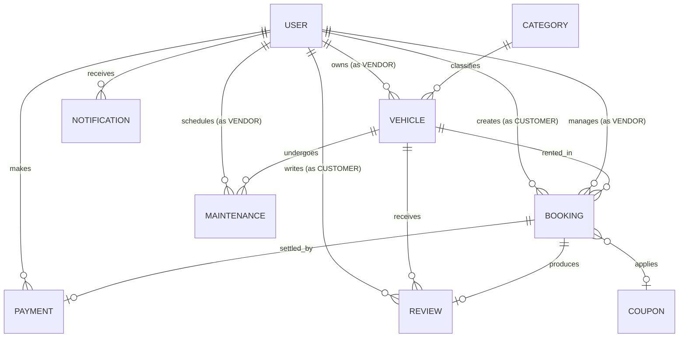

# 06 — Database Architecture & Data Models

RentRide uses **MongoDB** as its primary data store, managed through the **Mongoose 8** Object Data Modeling (ODM) library.

---

## 1. Entity-Relationship Diagram (ERD)

---

## 2. Data Models & Schemas

### 1. User Model (`User` -> `users`)
Defines credentials, role assignments, and role-specific profile extensions.

* **File**: [`server/src/models/user.model.js`](file:///c:/Users/vansh/OneDrive/Desktop/Project/RentRide/server/src/models/user.model.js)

| Field | Type | Required | Default | Description / Enums / Validation |
| :--- | :--- | :---: | :---: | :--- |
| `_id` | ObjectId | Auto | Auto | Unique MongoDB Identifier |
| `name` | String | Yes | — | Min 2, max 60 chars, trimmed |
| `email` | String | Yes | — | Unique, lowercase, valid email format regex |
| `password` | String | Yes | — | Min 6 chars, hashed via bcrypt before save, `select: false` |
| `phone` | String | No | `""` | Contact phone number |
| `role` | String | Yes | `'CUSTOMER'` | Enum: `['CUSTOMER', 'VENDOR', 'ADMIN']` |
| `avatar.url` | String | No | `""` | Cloudinary asset URL |
| `avatar.publicId` | String | No | `""` | Cloudinary public identifier |
| `isActive` | Boolean | Yes | `true` | Account active state |
| `vendorProfile.businessName` | String | No | `""` | Registered vendor trade name |
| `vendorProfile.gstNumber` | String | No | `""` | Tax identification number |
| `vendorProfile.address` | Object | No | `{}` | `{ street, city, state, pincode }` |
| `vendorProfile.isApproved` | Boolean | Yes | `false` | Admin verification flag |
| `vendorProfile.commissionRateOverride` | Number | No | `null` | Custom negotiated platform commission rate (e.g. `0.10`) |
| `customerProfile.drivingLicenseNumber` | String | No | `""` | Driver's license number for verification |
| `customerProfile.drivingLicenseUrl` | String | No | `""` | Uploaded license document URL |
| `customerProfile.kycStatus` | String | Yes | `'PENDING'` | Enum: `['PENDING', 'VERIFIED', 'REJECTED']` |
| `createdAt` / `updatedAt` | Date | Auto | Auto | Timestamps |

* **Indexes**: `{ email: 1, role: 1 }`
* **Hooks**: `pre('save')` hashes password with bcrypt (10 rounds) if modified.
* **Instance Methods**: `isPasswordCorrect(candidatePassword)`, `generateAccessToken()`.

---

### 2. Vehicle Model (`Vehicle` -> `vehicles`)
Represents an individual vehicle listed by a vendor.

* **File**: [`server/src/models/vehicle.model.js`](file:///c:/Users/vansh/OneDrive/Desktop/Project/RentRide/server/src/models/vehicle.model.js)

| Field | Type | Required | Default | Description / Validation |
| :--- | :--- | :---: | :---: | :--- |
| `_id` | ObjectId | Auto | Auto | Unique MongoDB Identifier |
| `vendorId` | ObjectId | Yes | — | Ref: `User` |
| `categoryId` | ObjectId | Yes | — | Ref: `Category` |
| `brand` | String | Yes | — | Vehicle brand (e.g., 'Royal Enfield', 'Hyundai') |
| `model` | String | Yes | — | Vehicle model (e.g., 'Hunter 350', 'Creta') |
| `registrationNumber` | String | Yes | — | Unique, uppercase vehicle license plate |
| `year` | Number | Yes | — | Manufacturing year (min 2000, max current year + 1) |
| `fuelType` | String | Yes | — | Enum: `['petrol', 'diesel', 'electric', 'cng', 'hybrid']` |
| `transmission` | String | Yes | — | Enum: `['manual', 'automatic']` |
| `seatingCapacity` | Number | Yes | — | Min 1 |
| `engineCapacity` | Number | No | `null` | Engine displacement in cc (or kWh for EVs) |
| `location.city` | String | Yes | — | Operating city hub (e.g., 'Indore', 'Bhopal', 'Gwalior') |
| `location.state` | String | No | `""` | State name |
| `location.address` | String | No | `""` | Pickup location / physical hub address |
| `location.coordinates` | Object | No | `{ lat: 0, lng: 0 }` | Geographic coordinates |
| `images` | Array | No | `[]` | Array of `{ url, publicId, isPrimary }` |
| `features` | Array | No | `[]` | Array of strings (e.g. `['Bluetooth', 'Helmet Included']`) |
| `pricing.hourlyRate` | Number | Yes | — | Min ₹10 |
| `pricing.rate12Hour` | Number | Yes | — | Min ₹50 |
| `pricing.rate24Hour` | Number | Yes | — | Min ₹100 |
| `pricing.minRentalHours` | Number | No | `1` | Min rental duration requirement |
| `pricing.securityDeposit` | Number | No | `1000` | Refundable deposit held during rental |
| `status` | String | Yes | `'AVAILABLE'` | Enum: `['AVAILABLE', 'RENTED', 'MAINTENANCE', 'INACTIVE']` |
| `ratingAverage` | Number | No | `0` | Calculated average (0 to 5, 1 decimal place) |
| `ratingCount` | Number | No | `0` | Total number of verified customer reviews |
| `isApproved` | Boolean | Yes | `true` | Admin moderation flag |
| `mileageLimitPerDayKm` | Number | No | `250` | Included daily mileage cap |
| `extraKmCharge` | Number | No | `10` | Rate per km exceeded (₹10/km) |
| `createdAt` / `updatedAt` | Date | Auto | Auto | Timestamps |

* **Indexes**:
  * `{ categoryId: 1, status: 1, isApproved: 1 }`
  * `{ 'location.city': 1, status: 1 }`
  * `{ vendorId: 1, status: 1 }`
  * `{ brand: 1, model: 1 }`
  * `{ 'pricing.hourlyRate': 1 }`

---

### 3. Booking Model (`Booking` -> `bookings`)
Records rental reservations, pricing breakdowns, offline walk-ins, and checkout locks.

* **File**: [`server/src/models/booking.model.js`](file:///c:/Users/vansh/OneDrive/Desktop/Project/RentRide/server/src/models/booking.model.js)

| Field | Type | Required | Default | Description / Validation |
| :--- | :--- | :---: | :---: | :--- |
| `_id` | ObjectId | Auto | Auto | Unique MongoDB Identifier |
| `bookingNumber` | String | Yes | Auto | Unique human-readable code (e.g., `RR-20260831-ABC12`) |
| `vehicleId` | ObjectId | Yes | — | Ref: `Vehicle` |
| `vendorId` | ObjectId | Yes | — | Ref: `User` |
| `customerId` | ObjectId | No | `null` | Ref: `User` (null for offline walk-in bookings) |
| `offlineCustomer` | Object | No | `{}` | `{ name, phone, drivingLicenseNumber, notes }` |
| `bookingType` | String | Yes | `'ONLINE'` | Enum: `['ONLINE', 'OFFLINE']` |
| `rentalPlan` | String | Yes | — | Enum: `['HOURLY', '12_HOURS', '24_HOURS']` |
| `startDateTime` | Date | Yes | — | Rental start timestamp |
| `endDateTime` | Date | Yes | — | Rental end timestamp |
| `durationHours` | Number | Yes | — | Rental duration in hours (min 1) |
| `priceBreakdown` | Object | Yes | — | Detailed financial audit object |
| `priceBreakdown.basePrice` | Number | Yes | — | Base rate before multipliers |
| `priceBreakdown.surgeMultiplier` | Number | No | `1.0` | Weekend surge multiplier |
| `priceBreakdown.couponDiscount` | Number | No | `0` | Applied coupon discount |
| `priceBreakdown.subtotal` | Number | Yes | — | Net rental fee |
| `priceBreakdown.platformFee` | Number | Yes | — | 5% platform service fee |
| `priceBreakdown.taxAmount` | Number | Yes | — | 18% GST |
| `priceBreakdown.securityDeposit` | Number | Yes | — | Refundable deposit |
| `priceBreakdown.totalAmount` | Number | Yes | — | Total payable by customer |
| `priceBreakdown.vendorPayout` | Number | Yes | — | Net vendor payout amount |
| `priceBreakdown.platformCommission` | Number | Yes | — | Net platform commission amount |
| `status` | String | Yes | `'PENDING_PAYMENT'` | Enum: `['PENDING_PAYMENT', 'CONFIRMED', 'ACTIVE', 'COMPLETED', 'CANCELLED', 'EXPIRED']` |
| `paymentStatus` | String | Yes | `'PENDING'` | Enum: `['PENDING', 'COMPLETED', 'FAILED', 'REFUNDED']` |
| `couponApplied` | ObjectId | No | `null` | Ref: `Coupon` |
| `cancellationDetails` | Object | No | `{}` | `{ cancelledBy, reason, cancelledAt, refundAmount, cancellationFee }` |
| `lockExpiresAt` | Date | Yes | `Date.now + 10m` | Temporary checkout reservation lock expiry |
| `createdAt` / `updatedAt` | Date | Auto | Auto | Timestamps |

* **Collision & Query Indexes**:
  * `{ vehicleId: 1, startDateTime: 1, endDateTime: 1, status: 1 }` (Primary collision check index)
  * `{ customerId: 1, createdAt: -1 }`
  * `{ vendorId: 1, startDateTime: -1 }`
  * `{ status: 1, lockExpiresAt: 1 }`

---

### 4. Category Model (`Category` -> `categories`)
Defines vehicle classifications (Two-Wheelers & Four-Wheelers).

* **File**: [`server/src/models/category.model.js`](file:///c:/Users/vansh/OneDrive/Desktop/Project/RentRide/server/src/models/category.model.js)

| Field | Type | Required | Default | Description |
| :--- | :--- | :---: | :---: | :--- |
| `name` | String | Yes | — | Unique, max 50 chars (e.g. 'Electric Scooters', 'SUVs') |
| `slug` | String | Yes | Auto | URL slug (e.g. 'electric-scooters') generated in pre-validate hook |
| `type` | String | Yes | — | Enum: `['two_wheeler', 'four_wheeler']` |
| `iconUrl` | String | No | `""` | Category display image |
| `description` | String | No | `""` | Description of category |
| `isActive` | Boolean | Yes | `true` | Visibility flag |

---

### 5. Coupon Model (`Coupon` -> `coupons`)
Manages discount vouchers and user usage limits.

* **File**: [`server/src/models/coupon.model.js`](file:///c:/Users/vansh/OneDrive/Desktop/Project/RentRide/server/src/models/coupon.model.js)

| Field | Type | Required | Default | Description |
| :--- | :--- | :---: | :---: | :--- |
| `code` | String | Yes | — | Unique uppercase coupon code (e.g., `RENTRIDE50`) |
| `discountType` | String | Yes | — | Enum: `['PERCENTAGE', 'FIXED']` |
| `discountValue` | Number | Yes | — | Discount rate (e.g., 20% or ₹200) |
| `minBookingAmount` | Number | No | `0` | Minimum base amount required |
| `maxDiscountAmount` | Number | No | `null` | Cap for percentage discounts (e.g., max ₹500) |
| `validFrom` / `validUntil` | Date | Yes | — | Validity window |
| `totalUsageLimit` | Number | No | `500` | Global usage quota |
| `perUserLimit` | Number | No | `1` | Max times an individual user can redeem |
| `usageCount` | Number | Yes | `0` | Current global redemption count |
| `usedBy` | Array | No | `[]` | Array of `{ userId, bookingId, usedAt }` |
| `isActive` | Boolean | Yes | `true` | Active status toggle |

---

### 6. Payment Model (`Payment` -> `payments`)
Stores Razorpay transactions, gateway order IDs, and verification signatures.

* **File**: [`server/src/models/payment.model.js`](file:///c:/Users/vansh/OneDrive/Desktop/Project/RentRide/server/src/models/payment.model.js)

| Field | Type | Required | Default | Description |
| :--- | :--- | :---: | :---: | :--- |
| `bookingId` | ObjectId | Yes | — | Ref: `Booking` |
| `userId` | ObjectId | No | `null` | Ref: `User` |
| `razorpayOrderId` | String | No | `null` | Razorpay order reference ID |
| `razorpayPaymentId` | String | No | `null` | Captured payment ID from gateway |
| `razorpaySignature` | String | No | `null` | HMAC SHA256 signature string |
| `amount` | Number | Yes | — | Transaction amount in INR |
| `currency` | String | No | `'INR'` | Currency code |
| `status` | String | Yes | `'PENDING'` | Enum: `['PENDING', 'COMPLETED', 'FAILED', 'REFUNDED']` |
| `paymentMethod` | String | No | `'other'` | Enum: `['card', 'upi', 'netbanking', 'wallet', 'offline_cash', 'other']` |
| `refundDetails` | Object | No | `{}` | `{ refundId, amount, status, reason, processedAt }` |

---

### 7. Review Model (`Review` -> `reviews`)
Verified customer feedback with automatic aggregate vehicle rating recalculation.

* **File**: [`server/src/models/review.model.js`](file:///c:/Users/vansh/OneDrive/Desktop/Project/RentRide/server/src/models/review.model.js)

| Field | Type | Required | Default | Description |
| :--- | :--- | :---: | :---: | :--- |
| `bookingId` | ObjectId | Yes | — | Unique Ref: `Booking` (1 review per booking) |
| `vehicleId` | ObjectId | Yes | — | Ref: `Vehicle` |
| `vendorId` | ObjectId | Yes | — | Ref: `User` |
| `customerId` | ObjectId | Yes | — | Ref: `User` |
| `rating` | Number | Yes | — | 1 to 5 stars |
| `comment` | String | No | `""` | Text review (max 1000 chars) |
| `isModerated` | Boolean | Yes | `true` | Admin moderation flag |

* **Hooks & Aggregation**: `post('save')` and `post('findOneAndDelete')` execute `calculateAverageRating(vehicleId)` to update `ratingAverage` and `ratingCount` on the `Vehicle` document.

---

### 8. Maintenance Model (`Maintenance` -> `maintenances`)
Represents scheduled maintenance periods that block vehicle availability.

* **File**: [`server/src/models/maintenance.model.js`](file:///c:/Users/vansh/OneDrive/Desktop/Project/RentRide/server/src/models/maintenance.model.js)

| Field | Type | Required | Default | Description |
| :--- | :--- | :---: | :---: | :--- |
| `vehicleId` | ObjectId | Yes | — | Ref: `Vehicle` |
| `vendorId` | ObjectId | Yes | — | Ref: `User` |
| `maintenanceType` | String | Yes | `'routine'` | Enum: `['routine', 'repair', 'inspection', 'accident', 'cleaning']` |
| `description` | String | Yes | — | Work description |
| `cost` | Number | No | `0` | Incurred service cost |
| `startDate` / `endDate` | Date | Yes | — | Maintenance blockout period |
| `status` | String | Yes | `'SCHEDULED'` | Enum: `['SCHEDULED', 'IN_PROGRESS', 'COMPLETED', 'CANCELLED']` |
| `serviceCenterDetails` | Object | No | `{}` | `{ name, contact, invoiceUrl }` |

---

### 9. Notification Model (`Notification` -> `notifications`)
In-app alerts for critical system events.

* **File**: [`server/src/models/notification.model.js`](file:///c:/Users/vansh/OneDrive/Desktop/Project/RentRide/server/src/models/notification.model.js)

| Field | Type | Required | Default | Description |
| :--- | :--- | :---: | :---: | :--- |
| `recipientId` | ObjectId | Yes | — | Ref: `User` |
| `recipientRole` | String | Yes | — | Enum: `['CUSTOMER', 'VENDOR', 'ADMIN']` |
| `type` | String | Yes | `'SYSTEM_ANNOUNCEMENT'` | Enum: `['BOOKING_CONFIRMED', 'BOOKING_CANCELLED', 'PAYMENT_SUCCESS', 'PAYMENT_FAILED', 'MAINTENANCE_ALERT', 'VENDOR_APPROVAL', 'REVIEW_RECEIVED', 'SYSTEM_ANNOUNCEMENT']` |
| `title` | String | Yes | — | Short alert title |
| `message` | String | Yes | — | Descriptive message |
| `isRead` | Boolean | Yes | `false` | Read flag |
| `readAt` | Date | No | `null` | Timestamp when marked as read |

---

### 10. VehicleCatalog Model (`VehicleCatalog` -> `vehiclecatalogs`)
Master vehicle specifications and certified real-world catalog database. Standardizes vehicle specs, certified ARAI fuel economy, engine/battery capacities, and photography across all vendor rental listings.

* **File**: [`server/src/models/catalog.model.js`](file:///c:/Users/vansh/OneDrive/Desktop/Project/RentRide/server/src/models/catalog.model.js)

| Field | Type | Required | Default | Description |
| :--- | :--- | :---: | :---: | :--- |
| `catalogKey` | String | Yes | — | Unique natural slug identifier (e.g., `'tata-curvv-ev-empowered-plus-a-55-kwh'`). Indexed uniquely. |
| `brand` | String | Yes | — | Manufacturer (e.g., `'Tata'`, `'Ather'`, `'Maruti Suzuki'`). |
| `model` | String | Yes | — | Vehicle Model (e.g., `'Curvv EV'`, `'450X Gen 3'`). |
| `variant` | String | Yes | — | Specific variant trim (e.g., `'Empowered Plus A 55 kWh'`). |
| `categoryId` | ObjectId | Yes | — | Reference to `Category` (`'electric-scooters'`, `'hatchbacks'`, etc.). |
| `vehicleType` | String | Yes | — | Enum: `['two_wheeler', 'four_wheeler']`. |
| `fuelType` | String | Yes | — | Enum: `['petrol', 'diesel', 'electric', 'cng', 'hybrid']`. |
| `transmission` | String | Yes | — | Enum: `['manual', 'automatic']`. |
| `seatingCapacity` | Number | Yes | — | Seating capacity. |
| `engineCapacity` | Number | No | `null` | Engine displacement (cc) or battery capacity (kWh). |
| `fuelEconomy` | Object | Yes | — | `{ value: Number, unit: 'km/l'|'km/charge'|'km/kg', source: String }`. |
| `specifications` | Object | No | `{}` | `{ fuelTankCapacityLiters, batteryCapacityKwh, maxPowerBhp, maxTorqueNm, topSpeedKmph, dimensions }`. |
| `features` | [String] | No | `[]` | Verified factory equipment and features list. |
| `images` | [Object] | No | `[]` | `{ url: String, publicId: String, isPrimary: Boolean }` (Cloudinary CDN URLs). |
| `suggestedPricing`| Object | Yes | — | `{ hourlyRate: Number, rate12Hour: Number, rate24Hour: Number }`. |
| `isActive` | Boolean | Yes | `true` | Active status flag for catalog discovery. |

* **Indexes**:
  * `{ catalogKey: 1 }` (Unique)
  * `{ brand: 1, model: 1 }`
  * `{ categoryId: 1, isActive: 1 }`
  * `{ vehicleType: 1, fuelType: 1, transmission: 1 }`

