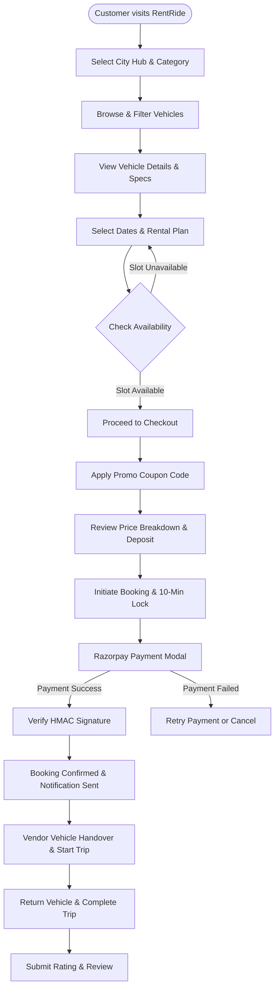
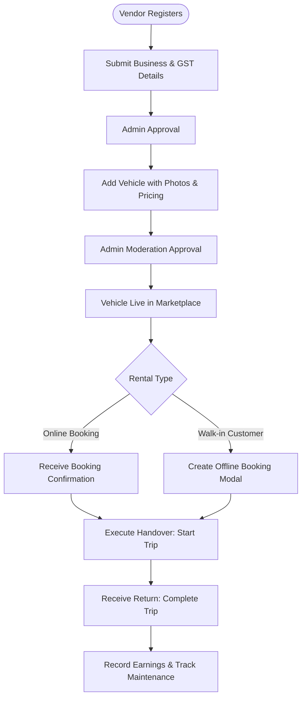
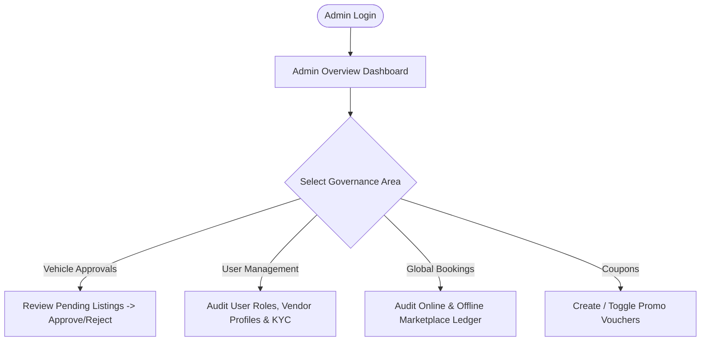

# 08 — User Journeys & Workflow Specifications

This document maps the primary user flows across Customer, Vendor, and Admin roles, detailing both happy paths and error recovery sequences.

---

## 1. Customer User Journey

### Steps in Detail:
1. **Discovery & Search**: User chooses operating hub (Indore, Bhopal, Gwalior) on the home or explore page, filtering by categories (e.g., Two-Wheelers vs Four-Wheelers), fuel type, and price range.
2. **Availability & Quote**: User selects `startDateTime`, `endDateTime`, and `rentalPlan` (`HOURLY`, `12_HOURS`, or `24_HOURS`). System runs dry-run availability check to guarantee zero collisions.
3. **Checkout & Reservation Lock**: Customer clicks "Proceed to Checkout". The system creates a `PENDING_PAYMENT` booking document with a 10-minute temporary inventory lock (`lockExpiresAt`).
4. **Payment**: Customer enters coupon code if available. Server computes verified breakdown. Razorpay modal processes transaction.
5. **Confirmation**: Server verifies HMAC-SHA256 signature, updates booking to `CONFIRMED`, and creates an in-app notification.
6. **Handover & Return**: At pickup time, vendor inspects license, notes start odometer, and starts trip (`ACTIVE`). On return, vendor notes final odometer and completes trip (`COMPLETED`).
7. **Post-Trip Review**: Customer visits My Bookings, rates the trip (1-5 stars), and writes feedback which automatically updates the vehicle's aggregate rating.

---

## 2. Vendor Fleet & Operations Journey

### Steps in Detail:
1. **Vendor Onboarding**: Vendor registers with business name, GST number, address, and operating city.
2. **Listing Creation**: Vendor clicks "Add Vehicle", specifies specs, sets pricing tiers (Hourly, 12-Hour, 24-Hour, deposit), and uploads up to 5 photos to Cloudinary.
3. **Walk-In Offline Rental**: When a physical customer walks into a hub, the vendor opens "Create Offline Booking", enters customer contact, license, dates, and cash collection, immediately blocking online inventory for that interval.
4. **Trip Dispatch**: Vendor executes "Start Trip" during vehicle handover, inputting initial odometer reading.
5. **Trip Return & Settlement**: Vendor executes "Complete Trip" on return. The system calculates extra km if mileage exceeds daily limits and tallies vendor net earnings.
6. **Maintenance Blackouts**: Vendor can schedule routine service or repair windows, instantly blocking vehicle availability.

---

## 3. Admin Governance Journey

---

## 4. Alternative & Exception Flows

### A. Overlapping Booking Collision Conflict
* **Trigger**: A customer or vendor attempts to book a time interval that overlaps with an existing confirmed booking, an active checkout lock, or a scheduled maintenance window.
* **System Action**: `BookingService.isVehicleAvailable` returns `{ available: false, reason: "Vehicle already reserved from ... to ..." }`.
* **User Feedback**: UI displays an alert banner explaining the exact conflict time window and prompts the user to select another slot.

### B. Payment Failure & Graceful Recovery
* **Trigger**: Razorpay gateway transaction fails or customer closes the modal.
* **System Action**: Frontend invokes `/api/payments/razorpay/fail`. Booking remains in `PENDING_PAYMENT` until `lockExpiresAt` (10 minutes).
* **Recovery**: Customer can re-open checkout and retry payment without recreating the booking before the lock expires.

### C. Booking Cancellation & Fee Computation
* **Trigger**: Customer cancels an upcoming booking from My Bookings.
* **System Action**: Server calculates refundable amount minus standard cancellation fee, records `cancellationDetails`, updates booking status to `CANCELLED`, and releases vehicle availability.

### D. Unauthorized Role Navigation
* **Trigger**: Customer manually attempts to access `/admin` or `/vendor` routes.
* **System Action**: `RoleRoute` in [`ProtectedRoute.jsx`](file:///c:/Users/vansh/OneDrive/Desktop/Project/RentRide/client/src/components/navigation/ProtectedRoute.jsx) intercepts request, redirects user to `/`, or displays an unauthorized alert.

---

## 5. Flow Gaps Identified for Review

| Flow Stage | Observed Code State | Recommendation / Action Item |
| :--- | :--- | :--- |
| **Direct Gateway Refund** | Cancellation records refund amount in database, but does not trigger `razorpay.payments.refund()` directly via API. | Add automatic Razorpay refund invocation in `BookingService.cancelBooking`. |
| **Expired Lock Auto-Reversion** | Bookings with `lockExpiresAt < now` are ignored during collision checks, but retain `PENDING_PAYMENT` status in database. | Add a periodic cron task or MongoDB TTL index to transition status to `EXPIRED`. |
| **External Vouchers** | Booking vouchers are generated on the frontend UI but not emailed as PDF. | Integrate Nodemailer or cloud PDF service for automated email receipts. |
