# RentRide — User Functionality Tree

> **Purpose:** Master editable functionality tree for RentRide.
> Edit the Mermaid `mindmap` below whenever a functionality is added, removed, renamed, or moved.
> Keep the hierarchy as the source of truth. Do not add technical implementation details here unless they are user-visible functionality.

## Editable Functionality Diagram

```mermaid
mindmap
  root((RentRide))
    Customer
      Account & Profile
        Register
        Login
        Logout
        View Profile
        Update Profile
        Upload Avatar
        Change Password
        Driving License
        KYC Status
      Vehicle Discovery
        Select City
          Indore
          Bhopal
          Gwalior
        Browse Categories
          Two-Wheelers
            Electric Scooters
            Scooters
            Bikes
          Four-Wheelers
            Hatchbacks
            Sedans
            SUVs
        Search Vehicles
        Multi-Filter
          Fuel Type
          Transmission
          Seating Capacity
          Price Range
        Sort Vehicles
        Nearest Available Rides
          Geolocation Discovery
          Distance Calculation
          Interval Collision Check
        Map Visualization
          Interactive Leaflet Map
          Pickup Hub Pins
          Google Maps Directions
        View Vehicle Details
          Specifications
            Fuel Economy & Mileage (km/l, km/kg, km/charge, km/kWh)
          Images
          Pricing
          Pickup Location Map
          Availability
      AI Capabilities
        Personalized Vehicle Recommendations
        AI Personalized Offers
          Behavioral Segmentation
          Dynamic Coupon Matching
          One-Click Promo Claim
        AI Rental Assistant
          Floating Chat Widget
          Conversational Vehicle Search
          Plan & Policy Explanation
          Safe Checkout CTA
        Vehicle Similarity
        Preference Matching
      Booking
        Select Vehicle
        Select Rental Plan
          Hourly
          12 Hours
          24 Hours
        Select Start Date & Time
        Select End Date & Time
        Automatic Fare Calculator
          Server-Side Authoritative Pricing
          Dynamic Surge Inclusion
          Coupon Discount Evaluation
          Taxes & Refundable Deposit
        Estimated Fuel & Energy Cost
          Distance Slider (10km - 500km)
          Multi-Energy Types (Petrol, Diesel, CNG, Electric)
          Regional Fuel Benchmarks (Indore, Bhopal, Gwalior)
        Check Availability
        Create Booking
        Temporary Checkout Lock
        View Booking Status
          Pending Payment
          Confirmed
          Active
          Completed
          Cancelled
          Expired
        Cancel Booking
        Cancellation Fee
        Refund Amount
      Checkout & Pricing
        View Price Breakdown
        Base Rental Price
        Weekend Surge
        Apply Coupon
        Platform Fee
        GST
        Security Deposit
        Final Amount
      Payment
        Razorpay Checkout
        UPI / Card Payment
        Payment Verification
        Payment Success
        Payment Failure
        Retry Payment
        Payment History
      My Bookings
        Booking History
        Upcoming Bookings
        Active Bookings
        Completed Bookings
        Booking Details
        Payment Details
        Rental Details
        Booking Receipt
      Trip & Rental
        Vehicle Handover
        OTP Verification
        Start Trip
        Start Odometer
        Active Rental Dashboard
          Live GPS Telemetry Sync
          GPS Accuracy Filtering (<60m)
          Speed Anomaly Suppression (<160 km/h)
          Stationary Drift Suppression
          Real-Time Elapsed Trip Counter
          Live OpenStreetMap Route Trace
          Live Estimated Fare Display
        Vehicle Return
          End Odometer
          Authoritative Odometer Billing Invariant
          Automatic Extra Kilometer Calculation
          Auto Extra KM Billing Reconciliation
        Complete Trip
      Reviews & Ratings
        Submit Review
        Submit Rating
        1–5 Star Rating
        Verified Review
        View Vehicle Rating
      Notifications
        Booking Confirmation
        Booking Cancellation
        Payment Notification
        Handover Notification
        View Notifications

    Vendor
      Account & Onboarding
        Register
        Login
        Logout
        Vendor Profile
        Business Information
        GST Information
        Business Address
        Operating City
        Vendor KYC
        Approval Status
      Dashboard
        Revenue
        Active Bookings
        Fleet Size
        Fleet Utilization
        Booking Statistics
        Earnings Analytics
        Vendor Rental Economics Calculator
          Rental Revenue Projection
          Extra KM Revenue Projection
          Platform Commission (12%)
          Net Vendor Earnings (88%)
        7-Day AI Demand Forecasting
          Multi-Dimensional Filter
          Daily Demand Surge Prediction
          Operational Insights
          Actionable Revenue Strategy
      Fleet Management
        View Vehicles
        Add Vehicle
        Edit Vehicle
        Delete Vehicle
        Update Vehicle Status
          Available
          Rented
          Maintenance
          Inactive
        Vehicle Specifications
          Fuel Economy & Mileage
          Adaptive Units (km/l, km/kg, km/charge, km/kWh)
        Vehicle Pricing
          Hourly Rate
          12-Hour Rate
          24-Hour Rate
          Security Deposit
        Vehicle Location
        Vehicle Images
        Upload Images
        Submit Vehicle for Approval
      Vehicle Approval
        View Approval Status
        Approved
        Rejected
        Listing Visibility
      Booking Management
        View Bookings
        View Booking Details
        Online Bookings
        Active Rentals
          Live Fleet Trip Telemetry
        Completed Rentals
      Walk-In / Offline Rentals
        Create Offline Booking
        Enter Customer Details
        Enter Driving License
        Select Vehicle
        Select Rental Dates
        Cash Payment
        Check Availability
        Block Vehicle Slot
      Vehicle Handover
        View Pickup Booking
        Verify Customer License
        OTP Verification
        Record Start Odometer
        Start Trip
        Mark Rental Active
      Vehicle Return
        Receive Vehicle
        Record End Odometer
        Authoritative Odometer Billing
        Calculate Extra Kilometers
        Calculate Extra Charges
        Complete Trip
        Auto Extra-KM Reconciliation
        Calculate Vendor Earnings (88% Payout)
      Maintenance
        Schedule Maintenance
        Routine Service
        Repair
        Set Maintenance Window
        Block Vehicle Availability
        Complete Maintenance
        Make Vehicle Available
      Earnings
        Booking Revenue
        Platform Commission (12%)
        GST
        Security Deposit
        Vendor Payout (88%)
        Net Earnings

    Admin
      Authentication
        Admin Login
        Role Authorization
        Protected Admin Access
      Dashboard
        Platform Overview
        Revenue
        Gross Bookings
        Platform Commission
        Fleet Size
        Booking Metrics
        User Metrics
        Vendor Metrics
        Platform Analytics
      User Management
        View Users
        Search Users
        Filter Users
        View Customers
        View Vendors
        View User Roles
        View Account Status
        Manage Users
      Vendor Management
        View Vendors
        View Vendor Profile
        View Business Details
        View GST Details
        View Approval Status
        Approve Vendor
        Reject Vendor
      KYC Management
        View Driving License
        View KYC Information
        View KYC Status
        Approve KYC
        Reject KYC
      Vehicle Management
        View Vehicles
        View Pending Vehicles
        Review Vehicle
        Approve Vehicle
        Reject Vehicle
        Manage Vehicle Visibility
      Booking Management
        Global Booking Ledger
        View Online Bookings
        View Offline Bookings
        View Booking Details
        View Booking Status
        Booking Audit
      Coupon Management
        Create Coupon
        Edit Coupon
        Delete Coupon
        Enable Coupon
        Disable Coupon
        Percentage Discount
        Fixed Discount
        Minimum Spend
        Expiry Date
        Redemption Limit
      Fuel & Energy Pricing
        City Fuel Rates
          Indore Benchmarks
          Bhopal Benchmarks
          Gwalior Benchmarks
        Multi-Energy Support (Petrol, Diesel, CNG, Electricity)
        Regional Price Configuration
      Analytics
        Revenue Analytics
        Booking Analytics
        Fleet Analytics
        Vendor Analytics
        Customer Analytics
        Commission Analytics
```



## How to Edit

### Add a functionality

Add it under the correct parent:

```text
Booking
  Select Vehicle
  Select Rental Plan
  Download Invoice   <-- add here
```

In Mermaid:

```text
        Download Invoice
```

### Add a new module

```text
Customer
  Wishlist
    Add Vehicle
    Remove Vehicle
    View Wishlist
```

### Rename

Change only the node text and preserve its position.

### Move

Cut the node and paste it under the new parent.

### Delete

Remove the node and its children if the whole branch is being removed.

---

# Functionality Change List

Use this section to record **only changes made by the user after the baseline tree**.

## Added

- [ ] `FUNCTIONALITY-ID` — Parent → New Functionality
- [ ] `FUNCTIONALITY-ID` — Parent → New Functionality

## Modified

- [ ] `OLD NAME` → `NEW NAME`
- [ ] `OLD PARENT → FUNCTIONALITY` → `NEW PARENT → FUNCTIONALITY`

## Removed

- [ ] `Parent → Removed Functionality`

## Moved

- [ ] `Old Parent → Functionality` → `New Parent → Functionality`

## Notes

- Reason for change:
- Expected behavior:
- Dependencies:
- Priority:

---

# Change Log

| Change ID | Type | Parent / Path | Change | Status |
|---|---|---|---|---|
| CHG-001 | ADD | Customer → Booking | Example new functionality | Pending |
| CHG-002 | MODIFY | Customer → Profile | Example rename | Pending |

> Replace the examples with actual changes. The change list is intentionally separate from the master tree so Antigravity can implement only approved changes.

---

# Antigravity Implementation Prompt

Use the prompt below after editing this file and reviewing the Change List.

## Prompt

You are working on the RentRide MERN project.

The file `RENT_RIDE_FUNCTIONALITY_TREE.md` is the user-facing functionality source of truth.

I have manually edited the functionality tree and recorded my requested changes in the **Functionality Change List** and **Change Log** sections.

Your task is to implement the approved functionality changes in the actual RentRide codebase.

### Rules

1. First inspect the entire existing codebase before changing anything.
2. Read:
   - `RENT_RIDE_FUNCTIONALITY_TREE.md`
   - project requirements/specifications
   - current architecture
   - database models
   - API routes/controllers/services
   - frontend routes/pages/components
   - authentication/authorization logic
3. Compare the current implementation against the edited functionality tree.
4. Extract ONLY the changes explicitly recorded in the Functionality Change List / Change Log.
5. Do not implement unrelated improvements or invent additional functionality.
6. For every requested change, determine all affected layers:
   - frontend UI
   - frontend state/API integration
   - backend route
   - controller
   - service/business logic
   - database model/schema
   - validation
   - authentication/authorization
   - notifications
   - payment logic
   - AI service
   - tests
   Include only layers actually required by the functionality.
7. Reuse the existing RentRide architecture, naming conventions, components, services, error handling, validation, and authorization patterns.
8. Preserve existing functionality. Do not break existing customer, vendor, admin, booking, payment, maintenance, review, notification, or AI functionality.
9. Enforce role-based access control for every new protected operation.
10. Keep business rules server-authoritative, especially availability, pricing, booking state, payment, and financial calculations.
11. Do not mark a functionality as implemented merely because a UI element exists. Verify the complete flow end-to-end.
12. Handle loading, empty, validation, error, success, and unauthorized states where applicable.
13. Update API documentation, database documentation, user-flow documentation, and functionality documentation when the implementation changes them.
14. Add or update tests for the affected functionality where the existing project test structure supports them.
15. Do not remove or rewrite existing functionality unless the Change List explicitly requests it.

### Required workflow

#### Phase 1 — Audit

Create an implementation impact analysis:

| Change ID | Requested Change | Existing Support | Missing Pieces | Files Likely Affected | Risk |
|---|---|---|---|---|---|

Do not modify code yet.

#### Phase 2 — Plan

For each approved change, provide:

- functionality
- user role
- user flow
- frontend changes
- backend changes
- database changes
- API changes
- authorization requirements
- validation requirements
- testing requirements

#### Phase 3 — Implement

Implement the approved changes completely across all required layers.

Follow the existing architecture rather than introducing a new architecture.

#### Phase 4 — Verify

For every implemented change:

- verify the frontend flow
- verify API request/response
- verify authorization
- verify validation
- verify database behavior
- verify error handling
- verify existing functionality is unaffected
- run available tests/build/lint checks

#### Phase 5 — Documentation

Update the functionality tree only after implementation is verified.

For each implemented change, update its status:

- `Implemented`
- `Partially Implemented`
- `Not Implemented`

Do not silently add unrelated functionality to the tree.

#### Phase 6 — Final Report

Return:

```text
IMPLEMENTATION SUMMARY

Change ID:
Functionality:
Status:
Files Changed:
API Changes:
Database Changes:
Frontend Changes:
Backend Changes:
Tests:
Verification:
Remaining Work:
```

Also provide a final list of:

1. Successfully implemented functionalities
2. Partially implemented functionalities
3. Failed/not implemented functionalities
4. Any assumptions made
5. Any manual steps required

### Important

The manually edited functionality tree represents the user's requested product changes, but it does NOT override security, data integrity, payment safety, or existing architectural constraints.

If a requested functionality conflicts with the existing architecture or creates a security/data-integrity issue, stop before implementation and clearly explain the conflict and the safest implementation approach.
